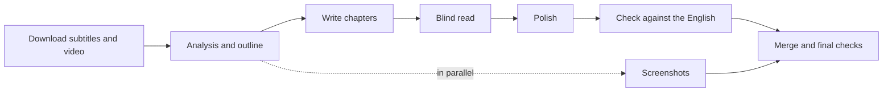

# interview-video-workflow

[中文](README.md) | English

An AI workflow that turns English YouTube interviews into long-form Chinese interview articles. Works with Claude Code and Codex.

Give it a video link and it downloads the subtitles, analyzes the content, writes the article chapter by chapter, polishes the Chinese, checks it against the original, and adds screenshots from the video. The result is a Markdown article with images.

> The output is written in Chinese, and the skills, rule cards and file names are in Chinese too. You can talk to the assistant in English. Folder and file names such as `素材` (materials) and `访谈长文` (interview article) are glossed below.

## Contents

- [Features](#features)
- [Requirements](#requirements)
- [Quick start](#quick-start)
- [Installation](#installation)
- [Usage](#usage)
- [Time and usage cost](#time-and-usage-cost)
- [How it works](#how-it-works)
- [Repository layout](#repository-layout)
- [Updating and uninstalling](#updating-and-uninstalling)
- [FAQ](#faq)
- [Limitations](#limitations)
- [Acknowledgements](#acknowledgements)

## Features

- **End-to-end pipeline**: download → transcript → analysis and outline → writing → blind read and polish → fidelity check → screenshots → final checks
- **Nothing silently dropped**: every transcript paragraph must be logged as written, merged or excluded (with a reason), and a script checks the log
- **Chinese quality checks**: a linter flags translationese, overuse of em dashes, judgmental wording about the interviewee, invented gestures ("he said with a smile"), and more
- **Blind read**: an AI reviewer that never sees the English reads the Chinese draft and points out passages that read like a translation
- **Screenshots from the source video**: frames are chosen to match the text, then checked so the caption matches what is actually on screen
- **Resumable**: every intermediate file is saved to disk, so an interrupted run picks up at the first missing step
- **Adapts to length**: interviews up to 30 minutes are handled in one session; longer ones are split across subagents

## Requirements

- Windows 10 / 11
- [Claude Code](https://claude.com/claude-code) or the [Codex](https://openai.com/codex) desktop app (either one)
- Python **3.11 or later** (the scripts run with `python -P`, which was added in 3.11), FFmpeg and yt-dlp. The installer sets these up for you

## Quick start

1. Download this repository and double-click `安装.cmd` ("install")
2. Fully quit and reopen Claude Code or Codex
3. Open the working folder in the assistant (by default `Documents\访谈长文`) and send:

```
Use the interview-video skill to turn this interview into a Chinese article: https://www.youtube.com/watch?v=xxxxxxxxxxx
```

After the analysis it pauses to show you the outline. Once you confirm, it finishes the remaining steps on its own.

## Installation

```bash
git clone https://github.com/songyang8964/interview-video-workflow.git
cd interview-video-workflow
```

Without git, click **Code → Download ZIP** on the repository page and unzip it.

Then run the installer, or just double-click `安装.cmd`:

```powershell
powershell -ExecutionPolicy Bypass -File install.ps1
```

The installer:

1. Checks dependencies: Python 3.11+ and FFmpeg (installing whatever is missing with winget), plus the Python packages `pillow` and `numpy`
2. Creates the working folder (default `Documents\访谈长文`), copies `tools/` into it and downloads `yt-dlp.exe`
3. Detects which assistant you have and copies the skills to `~/.claude/skills` and/or `~/.codex/skills`
4. Writes the project rules file `CLAUDE.md` / `AGENTS.md` into the working folder (an existing file is left alone)
5. Checks each item and lists what is ready and what is missing

Options:

| Option | Description | Default |
|---|---|---|
| `-WorkDir` | Working folder | `Documents\访谈长文` |
| `-Target` | Install for: `auto` / `claude` / `codex` / `both` | `auto` |
| `-SkipDeps` | Skip dependency installation and only copy files | — |

Restart your assistant afterwards so it loads the skills.

## Usage

Open the working folder in Claude Code or Codex and send:

```
Use the interview-video skill to turn this interview into a Chinese article: https://www.youtube.com/watch?v=xxxxxxxxxxx
```

In Claude Code you can also use the slash command:

```
/interview-video https://www.youtube.com/watch?v=xxxxxxxxxxx
```

By default it pauses once after the analysis to show you the outline. After you confirm, it runs the remaining steps and ends with a report: article path, character count, number of images, check results, and before/after pairs for the largest edits.

### Options

| Option | Description |
|---|---|
| `--auto` | Fully automatic; no pause at the outline |
| `--deep-polish` | Use adversarial polishing on key passages (needs the [adversarial-polish](https://github.com/jimliu/illustrated-agent-skills) skill, which the installer downloads) |
| `<slug>` | File name for this episode, e.g. `Snowden_JRE1368` |

Examples:

```
Use the interview-video skill on: <link> --auto
Use the interview-video skill on: <link> Snowden_JRE1368 --deep-polish
Continue the interview-video workflow: 素材\Snowden_JRE1368
```

### Output

```
访谈长文/                        # working folder
├── <slug>_访谈长文.md          # the finished article
├── <slug>_访谈长文_assets/     # screenshots
└── 素材/<slug>/                # materials: transcript, analysis pack, chapter drafts, check logs
```

Article structure: an opening (who the guest is, what they talk about, the show, date and link) → several chapters by topic, each with 1–2 bilingual Chinese/English quotes → a closing → endnotes (fact checks and background) → a review note (how many edits each step made, what was excluded, what is still unresolved).

The article is plain Markdown. Typora, Obsidian or VS Code are good for reading it.

## Time and usage cost

| Interview length | Approach | Measured |
|---|---|---|
| Up to 30 min | One session does everything; only the blind read and screenshots go to subagents | 24-minute interview: about 10 minutes, about 1.6M input tokens |
| Over 30 min | The main session only coordinates; analysis, writing, polishing, checking and screenshots go to subagents | Grows with length |

It uses your own assistant's quota. Downloading, transcript building, frame extraction and lint checks are done by scripts and cost no model usage. The numbers and trade-offs are in [docs/设计说明.md](docs/设计说明.md) (design notes, Chinese).

## How it works



1. **Writing, polishing and checking are separate steps.** Writing follows a Chinese outline, polishing looks only at the Chinese, and only the checking step compares against the English. This keeps the prose from following English sentence structure.
2. **Rules that can be counted are scripts.** `lint_zh.py` and `coverage.py` enforce them. The final article must pass three gates:
   - `lint_zh.py --full`: zero ERRORs, at most 4 em dashes per 1,000 characters, source link at both the start and the end
   - `coverage.py`: every transcript paragraph is logged; nothing is missing
   - Screenshots: every image has been checked against the source frame, and `frames.py insert` found exactly one place for each
3. **The blind reader is isolated.** It never sees the English. In Claude Code it is a separate subagent; in Codex, `blind_read.ps1` starts a separate `codex exec` process for each chapter.
4. **The approach depends on length.** A short transcript is small enough to keep in one session, which is faster and cheaper. Long interviews are split so the full transcript does not sit in the main session's context.

## Repository layout

```
.
├── 安装.cmd                  # double-click to install
├── install.ps1               # installer
├── skills/
│   ├── interview-video/      # main workflow (entry point)
│   │   └── references/       # past-mistakes list; polish, check and screenshot cards
│   ├── interview-analysis/   # interview analysis
│   ├── interview-writing/    # writing (writing card, translationese reference)
│   └── writing-style/        # Chinese style guide
├── tools/
│   ├── fetch.ps1             # download metadata, subtitles and video; build the transcript
│   ├── transcript.py         # json3 subtitles → timestamped transcript
│   ├── lint_zh.py            # Chinese quality linter
│   ├── coverage.py           # transcript coverage and chapter density check
│   ├── frames.py             # contact sheets, frame extraction, image insertion
│   ├── pack_chapter.py       # bundle each chapter's writing materials
│   ├── merge.py              # merge chapters and endnotes
│   ├── report.py             # summarize edits, blind-read notes and screenshots
│   ├── blind_read.ps1        # blind read (Codex)
│   └── blind_read_prompt.md
└── docs/
    ├── 设计说明.md            # design notes
    └── 项目规则.md            # project rules
```

Standalone usage of each script is in [docs/设计说明.md](docs/设计说明.md#脚本单独使用).

## Updating and uninstalling

**Update**: `git pull` (or download the ZIP again) and run the installer again. Previous skill versions are backed up to `~/.claude/skills_backup/<timestamp>` or `~/.codex/skills_backup/<timestamp>`. `CLAUDE.md` / `AGENTS.md` in the working folder are never overwritten; delete them first if you want the new rules.

**Uninstall**: delete `interview-video`, `interview-analysis`, `interview-writing` and `writing-style` from the skills folder (and `adversarial-polish` if nothing else uses it). The working folder holds your articles; remove it yourself if you no longer need it.

## FAQ

**"winget not found"**
Install or update "App Installer" from the Microsoft Store, then run the installer again.

**"Python is too old", or `unknown option -P`**
The `python` on your command line is older than 3.11. Uninstall the old version or move the newer Python ahead of it in PATH, then open a new PowerShell window and run the installer again.

**The assistant cannot find the interview-video skill**
Make sure you fully quit and reopened the assistant. Check that `~/.claude/skills/interview-video` or `~/.codex/skills/interview-video` exists; if not, run the installer again.

**Video download fails**
Run `tools\yt-dlp.exe -U` to update yt-dlp. If it still fails, ask the assistant to add `-CookiesFrom chrome` when downloading. If yt-dlp's error says it needs a JavaScript runtime, install one as it suggests (for example `winget install DenoLand.Deno`) and retry.

**"Anchor not unique" or "anchor not found" when inserting images**
An image's `anchor` in the screenshot plan appears more than once in the article, or no longer exists after edits. Ask the assistant to replace it with a passage that appears exactly once, then rerun `frames.py insert`.

**The run was interrupted**
Send `Continue the interview-video workflow: 素材\<slug>` and it resumes at the first unfinished step.

**Codex blind read says the model is not supported**
Pass a different model to `blind_read.ps1`, e.g. `-Model gpt-5.6-terra`.

## Limitations

- YouTube auto-captions do not identify speakers, so who said what is inferred from context and can be wrong
- Reversed meanings and misattributed quotes cannot be caught by scripts and rely on the line-by-line check; spot-check important pieces yourself
- Single-camera or remote interviews offer few usable frames
- Runs consume your assistant's quota, roughly in proportion to the interview length

## Acknowledgements

- `interview-analysis`, `interview-writing` and `writing-style` extend [jimliu/illustrated-agent-skills](https://github.com/jimliu/illustrated-agent-skills)
- Frame extraction and image quality code is ported from [video-notes](https://github.com/songyang8964/video-notes)
- Downloads use [yt-dlp](https://github.com/yt-dlp/yt-dlp)
