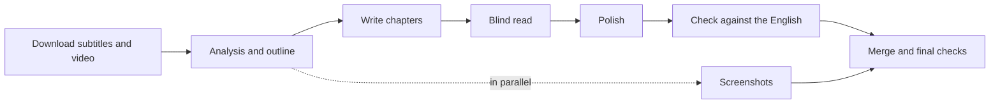

# interview-video-workflow

[中文](README.md) | English

An AI workflow that turns English YouTube interviews into long-form Chinese articles that read as if a Chinese writer wrote them, illustrated with screenshots from the original video. Works with Claude Code and Codex.

All you do is paste a video link into your AI assistant. It downloads the subtitles, analyzes the content, writes chapter by chapter, polishes the Chinese, checks it against the original, picks screenshots from the video, and hands you a Markdown article plus a review report.

> The output is written in Chinese, and the skills, rule cards and file names are in Chinese too. You can talk to the assistant in English. Folder and file names such as `素材` (materials) and `访谈长文` (interview article) are glossed below.

## Contents

- [Example](#example)
- [Features](#features)
- [Requirements](#requirements)
- [Quick start](#quick-start)
- [Installation](#installation)
- [Usage](#usage)
- [What each step produces](#what-each-step-produces)
- [Time and usage cost](#time-and-usage-cost)
- [How it works](#how-it-works)
- [Repository layout](#repository-layout)
- [Updating and uninstalling](#updating-and-uninstalling)
- [FAQ](#faq)
- [Limitations](#limitations)

## Example

Machine translation and ordinary AI summaries tend to fail in three ways: the sentences follow English structure, the sharpest passages quietly disappear, and the editor can't resist telling the reader what to think. This workflow targets all three. Some real edits:

| Literal translation | What this workflow writes | Why |
|---|---|---|
| 他的叙事起点是二战结束后的英国 | 洛从二战结束后的英国讲起 | "His narrative starting point" → "Lowe starts from…" |
| 被误导的利他主义 | 好心办坏事的利他主义 | "Misguided altruism" → a native idiom ("good intentions, bad results") |
| 这一工程的下游后果 | 这一系列政策造成的后果 | "Downstream consequences" is an English collocation |
| 我变成了可选项 | 已经可以没有我了 | "I became optional" → "they can do without me now" |

Nothing is dropped: every transcript paragraph must be logged as written into the article or excluded with a reason (ads, small talk), and a script checks every one. When something the guest says conflicts with public records, it is noted in the endnotes; the body text does not interrupt the guest.

Measured on a 24-minute interview: about 10 minutes end to end, producing a 6,500-character article in 3 chapters with 3 screenshots, plus endnotes and a review note.

## Features

- **End-to-end pipeline**: download → transcript → analysis and outline → writing → blind read and polish → fidelity check → screenshots → final checks
- **Nothing silently dropped**: every transcript paragraph is logged, and a script checks the log
- **Chinese quality checks**: a linter flags translationese, overuse of em dashes, judgmental wording about the interviewee, invented gestures ("he said with a smile"), and more
- **Blind read**: an AI reviewer that never sees the English reads the Chinese and points out passages that read like a translation
- **Guest's own words protected**: the guest's metaphors, examples and memorable lines are listed separately; polishing may reword them but never delete them
- **Screenshots from the source video**: chosen to match the text, then checked so the caption describes what is actually on screen
- **Resumable**: every intermediate file is saved to disk; if your quota runs out or the window closes, it continues from the first unfinished step
- **Adapts to length**: interviews up to 30 minutes are handled in one session; longer ones are split across subagents

## Requirements

| What | Notes |
|---|---|
| OS | Windows 10 / 11 |
| AI assistant (either one, signed in) | **Claude**: the Code feature in the Claude desktop app, or the [Claude Code](https://claude.com/claude-code) CLI<br>**Codex**: the [Codex](https://openai.com/codex) desktop app |
| Network | Access to YouTube and GitHub (for the video, yt-dlp and one optional skill) |
| Disk | A few hundred MB per interview (720p video; delete it when done) |
| Software | Python **3.11 or later**, FFmpeg, yt-dlp. **You don't need to install these yourself**; the installer does it |

Python 3.11 is required because the scripts run with `python -P`, which was added in 3.11.

## Quick start

**1. Download.** Click the green **Code** button at the top of this page, choose **Download ZIP**, and unzip it anywhere.

**2. Install.** Double-click `安装.cmd` ("install") in the unzipped folder.
- It installs the required software, creates a `访谈长文` folder in Documents, and installs the writing rules into your AI assistant
- If Windows asks "Do you want to allow this app to make changes to your device?", click Yes
- When every line shows `[好]` ("ready"), you're done. If any line shows `[缺]` ("missing"), follow its hint, close the window and double-click again

**3. Start.** Fully quit your AI assistant (right-click its icon in the system tray and quit; closing the window is not enough), reopen it, open the `Documents\访谈长文` folder, and send:

```
Use the interview-video skill to turn this interview into a Chinese article: https://www.youtube.com/watch?v=xxxxxxxxxxx
```

For what happens next, see [First run](#first-run).

## Installation

### With the installer (recommended)

Clone with git:

```bash
git clone https://github.com/songyang8964/interview-video-workflow.git
cd interview-video-workflow
```

Then double-click `安装.cmd`, or run in PowerShell:

```powershell
powershell -ExecutionPolicy Bypass -File install.ps1
```

The installer runs five steps and shows progress for each:

1. **Dependencies**: Python 3.11+ and FFmpeg, installing whatever is missing with winget; then the Python packages `pillow` and `numpy`
2. **Working folder** (default `Documents\访谈长文`): copies `tools\` and downloads `yt-dlp.exe`
3. **Skills**: detects which assistant you have and copies the skills to `~/.claude/skills` and/or `~/.codex/skills`, backing up any older version first. It also downloads `adversarial-polish` for deep polishing; if that download fails, everything else still works
4. **Project rules**: writes `CLAUDE.md` (read by Claude) / `AGENTS.md` (read by Codex) into the working folder; an existing file is left alone
5. **Final check**: shows `[好]` (ready) or `[缺]` (missing) for each item, with what to do about anything missing

You can run the installer again at any time; finished parts are skipped.

Options:

| Option | Description | Default |
|---|---|---|
| `-WorkDir` | Working folder | `Documents\访谈长文` |
| `-Target` | Install for: `auto` (whatever is detected) / `claude` / `codex` / `both` | `auto` |
| `-SkipDeps` | Skip dependency installation and only copy files | — |

For example, to put the working folder on drive D and install for Claude only:

```powershell
powershell -ExecutionPolicy Bypass -File install.ps1 -WorkDir "D:\访谈长文" -Target claude
```

### Manual installation

If the installer can't run (for example, a work PC without winget), do the same steps by hand:

1. Install [Python 3.11+](https://www.python.org/downloads/) (tick "Add python.exe to PATH") and [FFmpeg](https://www.gyan.dev/ffmpeg/builds/) (add its `bin` folder to PATH), then run `python -m pip install --user pillow numpy`
2. Create a working folder and copy the repository's `tools\` folder into it. Download `yt-dlp.exe` from the [yt-dlp releases page](https://github.com/yt-dlp/yt-dlp/releases/latest) into the working folder's `tools\`
3. Copy the four folders under the repository's `skills\` into `%USERPROFILE%\.claude\skills\` (for Codex, `%USERPROFILE%\.codex\skills\`). Then, in every `.md` file inside them, replace `<技能目录>` ("skills directory") with the full path of that skills folder
4. Copy `docs\项目规则.md` into the working folder and rename it `CLAUDE.md` (for Codex, `AGENTS.md`)

## Usage

### First run

Open the working folder in your assistant and send:

```
Use the interview-video skill to turn this interview into a Chinese article: https://www.youtube.com/watch?v=xxxxxxxxxxx
```

In Claude Code you can also use the slash command `/interview-video <link>`.

What happens next:

1. **Download** (about 1–3 minutes): the assistant looks up the title, channel and length, then downloads the subtitles and video. It will ask for permission to run commands and access the network; allow it.
2. **Analysis, then a pause for you**: the assistant reads the full transcript and shows you an outline:
   - how many chapters, each with a title and time range
   - the main points of each chapter
   - names and terms whose translation it is unsure about
   - places where it can't tell who is speaking

   Reply "confirm" if it looks right, or just say what to change, e.g. "merge chapters 2 and 3" or "translate Lowe as 洛".
3. **Writing, polishing, checking, screenshots**: these run on their own; you don't need to do anything. Screenshot selection starts in the background as soon as the analysis is done, in parallel with the writing.
4. **Report**: at the end you get a report with:
   - the article path, character count and number of screenshots
   - whether the three checks (Chinese quality, transcript coverage, screenshot verification) passed, with numbers
   - what the fidelity check corrected
   - before/after pairs for the 5 largest edits, so you can spot-check in a few minutes

To skip the outline pause, add `--auto` to the end of your message; the outline then comes with the final report.

### Common requests

| You want to | Send |
|---|---|
| Run without stopping | `Use the interview-video skill on: <link> --auto` |
| Polish more carefully (uses more quota) | `Use the interview-video skill on: <link> --deep-polish` |
| Choose the file name | `Use the interview-video skill on: <link> Snowden_JRE1368` |
| Resume after an interruption | `Continue the interview-video workflow: 素材\Snowden_JRE1368` |
| Get another round of critique on a finished article | `Run another blind read on 素材\Snowden_JRE1368, apply the sensible suggestions, then rerun the three gates` |
| Change one chapter | `Revise chapter 2 of 素材\Snowden_JRE1368: …, then re-merge, reinsert images and rerun the three gates` |
| Process a non-English interview | `Use the interview-video skill on: <link> — the video is in German` |

Switches like `--auto` are just hints for the AI; saying "run it fully automatically" or "polish deeply" works the same.

### Options

| Option | Description |
|---|---|
| `--auto` | Fully automatic; no pause at the outline |
| `--deep-polish` | Use adversarial polishing on the passages the blind reader flagged and on the opening and closing (needs the [adversarial-polish](https://github.com/jimliu/illustrated-agent-skills) skill, which the installer downloads) |
| `<slug>` | Short English name for this episode, used for file names. Defaults to `Guest_Show_Episode` |

### Viewing and sharing the result

Everything is in the working folder:

```
访谈长文\
├── Snowden_JRE1368_访谈长文.md          the article
├── Snowden_JRE1368_访谈长文_assets\     its screenshots
└── 素材\Snowden_JRE1368\                transcript, analysis and check logs; usually you can ignore these
```

The article is Markdown. Open it with [Typora](https://typora.io/), [Obsidian](https://obsidian.md/) or [VS Code](https://code.visualstudio.com/) to see the images; Notepad only shows text. When sharing, send the article together with its `_assets` folder.

Article structure:

1. **Opening**: who the guest is, what they talk about, and the source (show, date, link to the video)
2. **Body**: chapters by topic. Each heading states the chapter's conclusion, not just its topic; each chapter has 1–2 bilingual Chinese/English quotes
3. **Closing**: a plain ending with the video link
4. **Endnotes**: fact checks and background. Where the guest's claims differ from public records, it is explained here
5. **Review note**: how many edits polishing, the blind read and the fidelity check made, what was excluded, and what is still unresolved

### Editing the article yourself

The article is merged from the chapter files in `素材\<slug>\chapters\`. Every later merge (for example, after you ask the assistant to change a chapter) overwrites the article, so edits you make directly in it are lost. The previous version is saved as `<slug>_访谈长文.上一版.md` ("previous version"), but only one copy is kept.

So:

- If the assistant still needs to make changes, ask it to; it edits the chapter files and re-merges
- Do your own final edits after the assistant is completely done

## What each step produces

Each step's output is saved under `素材\<slug>\`. This is also how resuming works: steps whose output already exists are skipped, and work continues from the first missing one.

| Step | What it does | Output |
|---|---|---|
| 1 Download | Downloads metadata, subtitles and 720p video; builds a timestamped transcript in 30–60 second paragraphs | `source.info.json`, `source.*.json3`, `video.mp4`, `transcript.md` |
| 2 Analysis | Extracts key points, quotes and the guest's own wording; splits chapters; fixes translations of names and terms | `分析素材包.md` (analysis pack), `译名表.md` (glossary) |
| 3 Writing | Writes each chapter from the outline, then runs the Chinese linter | `chapters\01.md`, `02.md`, … |
| 4 Blind read and polish | A reviewer who hasn't seen the English critiques the text; polishing follows | `盲读\` (blind read), `润色记录*.json` (polish log) |
| 5 Fidelity check | Compares paragraph by paragraph with the English, logs each paragraph, fixes distortion and bias | `核对\覆盖表*.csv` (coverage table), `核对\审查*.md` (review) |
| 6 Screenshots | Picks frames from contact sheets, extracts full-resolution frames, checks them against the text | `配图计划.json` (screenshot plan), `<slug>_访谈长文_assets\` |
| 7 Final | Writes endnotes and the review note, merges, inserts images, runs the three gates | `文末附注.md` (endnotes), the article, `lint.json` |

## Time and usage cost

| Interview length | Approach | Measured |
|---|---|---|
| Up to 30 min | One session does everything; only the blind read and screenshots go to subagents | 24-minute interview: about 10 minutes, about 1.6M input tokens |
| Over 30 min | The main session only coordinates; analysis, writing, polishing, checking and screenshots go to subagents | Grows with length |

It uses your own assistant's quota. Downloading, transcript building, frame extraction and lint checks are done by scripts and cost no model usage. Start long interviews when you have quota to spare; if it runs out midway, send "Continue the interview-video workflow: 素材\<slug>" once it resets. The numbers and trade-offs are in [docs/设计说明.md](docs/设计说明.md) (design notes, Chinese).

## How it works



1. **Writing, polishing and checking are separate, and each sees different material.** Writing follows Chinese notes and uses the English only to check numbers and names; polishing sees only the Chinese; only the fidelity check compares line by line against the English, looking for omissions and distortion. Writing with the English open is the main source of translationese.
2. **Rules that can be counted are scripts.** Models don't reliably follow rules written in a prompt, so everything countable is checked by `lint_zh.py` and `coverage.py`. The article must pass three gates:
   - `lint_zh.py --full`: zero ERRORs, at most 4 em dashes per 1,000 characters, a source link at both the start and the end, and a review note
   - `coverage.py`: every transcript paragraph is logged, and every exclusion has a reason
   - Screenshots: every image has been checked against the source frame, and `frames.py insert` found exactly one place for each
3. **The blind reader is isolated.** It never sees the English. In Claude Code it is a separate subagent; in Codex, `blind_read.ps1` starts a separate `codex exec` process for each chapter.
4. **The rules come from rework.** Problems that forced rewrites in a dozen-plus earlier articles are collected in the [past-mistakes list](skills/interview-video/references/历史错误清单.md) (Chinese), and each one maps to a check in the pipeline.
5. **The approach depends on length.** A short transcript fits comfortably in one session, which is faster and cheaper. Long interviews are split so tens of thousands of words of transcript don't sit in the main session's context.

More design trade-offs are in [docs/设计说明.md](docs/设计说明.md).

## Repository layout

```
.
├── 安装.cmd                  # double-click to install
├── install.ps1               # installer
├── skills/                   # writing rules, installed into the AI assistant
│   ├── interview-video/      # main workflow (entry point)
│   │   └── references/       # past-mistakes list; polish, check and screenshot cards
│   ├── interview-analysis/   # interview analysis
│   ├── interview-writing/    # writing (writing card, translationese reference)
│   └── writing-style/        # Chinese style guide
├── tools/                    # scripts, copied into the working folder on install
│   ├── fetch.ps1             # download metadata, subtitles and video; build the transcript
│   ├── transcript.py         # json3 subtitles → timestamped transcript
│   ├── lint_zh.py            # Chinese quality linter
│   ├── coverage.py           # transcript coverage and chapter density check
│   ├── frames.py             # contact sheets, frame extraction, image insertion
│   ├── pack_chapter.py       # bundle each chapter's writing materials
│   ├── merge.py              # merge chapters and endnotes
│   ├── report.py             # summarize edits, blind-read notes and screenshots
│   ├── blind_read.ps1        # blind read (Codex)
│   └── blind_read_prompt.md
└── docs/
    ├── 设计说明.md            # design notes and standalone script usage
    └── 项目规则.md            # becomes CLAUDE.md / AGENTS.md in the working folder
```

Standalone usage of each script is in [docs/设计说明.md](docs/设计说明.md#脚本单独使用).

## Updating and uninstalling

**Update**: `git pull` (or download the ZIP again) and run the installer again. Previous skill versions are backed up to `~/.claude/skills_backup/<timestamp>` or `~/.codex/skills_backup/<timestamp>`. `CLAUDE.md` / `AGENTS.md` in the working folder are never overwritten; delete them first if you want the new rules.

**Uninstall**: delete `interview-video`, `interview-analysis`, `interview-writing` and `writing-style` from the skills folder (and `adversarial-polish` if nothing else uses it). The working folder holds your articles; remove it yourself if you no longer need it.

## FAQ

### Installation

**"winget not found" after double-clicking `安装.cmd`**
Open the Microsoft Store, search for "App Installer", install or update it, then double-click again.

**"Python is too old", or `unknown option -P` when running**
The `python` on your command line is older than 3.11. Uninstall the old version or move the newer Python ahead of it in PATH, then open a new PowerShell window and run the installer again.

**Python or FFmpeg was just installed but still shows `[缺]` (missing)**
Newly installed programs are only found in a new window. Close the window and double-click `安装.cmd` again.

**The assistant can't find the interview-video skill**
Make sure you quit it fully from the system tray and reopened it. Check that `~/.claude/skills/interview-video` or `~/.codex/skills/interview-video` exists; if not, run the installer again.

### Running

**Video download fails**
- Tell the assistant "update yt-dlp and retry"
- If that doesn't work, say "add -CookiesFrom chrome when downloading" to reuse your YouTube sign-in from Chrome (also needed for age-restricted or members-only videos)
- If the error says a JavaScript runtime is needed, install one as suggested (for example `winget install DenoLand.Deno`) and retry
- If the video still won't download, say "download only the subtitles and start writing"; the video can be fetched before the screenshot step

**Quota ran out, or the window was closed**
Everything finished so far is on disk. Reopen the assistant and send "Continue the interview-video workflow: 素材\<slug>"; it resumes where it stopped.

**"Anchor not unique" or "anchor not found" when inserting images**
An image's insertion point (`anchor`) in the screenshot plan appears more than once in the article, or no longer exists after edits. Ask the assistant to replace it with a passage that appears exactly once, then reinsert the images.

**Codex says the model is not supported**
Tell it "rerun the blind read with the gpt-5.6-terra model".

### Results

**Images don't show, or only their paths are visible**
Open the article in Typora, Obsidian or VS Code, and make sure the `_assets` folder sits next to the article.

**You doubt a particular translation**
Ask the assistant "what did the guest actually say for '…' in chapter 2?" and it will look up that point in the transcript.

## Limitations

- YouTube auto-captions don't identify speakers, so who said what is inferred from context. Uncertain spots get extra checking but can still be wrong
- Reversed meanings and misattributed quotes can't be caught by scripts and rely on the line-by-line check; spot-check important pieces yourself
- Remote or single-camera interviews offer few usable frames, usually one per chapter
- Runs consume your assistant's quota, more for longer interviews
- Windows only for now
