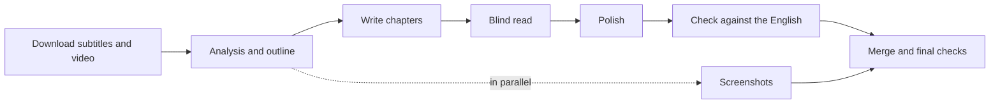

# interview-video-workflow

[中文](README.md) | English

**Turn English YouTube interviews into long-form Chinese articles that read like they were written in Chinese, illustrated with screenshots from the video.**

Paste a video link into Claude Code or Codex. The AI downloads the subtitles, writes, polishes, checks against the original, picks screenshots, and hands you a Markdown article with images plus a review report.

 

> The output is written in Chinese, and the skills and file names are in Chinese too. You can talk to the assistant in English. Folder names such as `素材` (materials) and `访谈长文` (interview articles) are glossed below.

## Contents

- [Overview](#overview)
- [Examples](#examples)
- [Features](#features)
- [Quick start](#quick-start)
- [Usage](#usage)
- [Updating and uninstalling](#updating-and-uninstalling)
- [FAQ](#faq)
- [Limitations](#limitations)
- [Developer reference](#developer-reference)

## Overview

Ask an AI to "translate this interview into a Chinese article" and you'll usually get something readable. But some problems are hard to spot on a single read:

1. **It reads like a translation.** Sentences follow English structure and idioms are translated word for word. Every sentence makes sense; together they don't read like Chinese.
2. **Content gets summarized or skipped.** In a long interview, the AI often squeezes passages into a one-line summary or drops them, then bridges the gap with a transition. The article still flows, so you can't tell anything is missing without going back to the video.
3. **Things get added that were never said.** For example, "he said with a smile" or "he paused" when nothing like that happens in the video.
4. **Meanings go wrong.** Negations get reversed and speakers get mixed up.

Telling an AI "don't leave anything out" or "avoid translationese" in a prompt doesn't reliably work. This project splits the job into separate steps, each with its own check, and the work isn't finished until every check passes. For example:

- Every paragraph of the transcript must be logged as "written into chapter N" or given a reason for leaving it out (ads, small talk). A program checks them one by one, so a single missing paragraph blocks completion
- The Chinese draft goes to an AI that has **never seen the English**, which picks out anything that reads like a translation or is hard to follow
- A final pass compares the text line by line with the English for mistranslations and mixed-up speakers

You don't need to know how any of this works. The AI runs it all and tells you the result of each check at the end.

## Examples

Some fixes from real revisions:

| English | Literal Chinese | What this workflow writes | Meaning of the rewrite |
|---|---|---|---|
| a fly on the wall | 墙上的一只苍蝇 | 在旁边悄悄看着 | "quietly watching from the side" |
| I've become optional | 我变成了可选项 | 已经可以没有我了 | "they can do without me now" |
| misguided altruism | 被误导的利他主义 | 好心办坏事的利他主义 | "good intentions, bad results" altruism |
| at peace with itself | 完全与自身和平共处的国家 | 安居乐业、人人互信的社会 | "a settled society where people trust each other" |
| born on second base | 从二垒起跑 | 一出生就占了先机 | "had a head start from birth" |
| fall in line | 乖乖排好队 | 乖乖照做 | "do as told" |
| It's a slippery slope | 这是一个滑坡 | 口子一开就收不住 | "once it starts, it can't be stopped" |
| downstream consequences | 这一工程的下游后果 | 这一系列政策造成的后果 | "the consequences of these policies" |
| physical report | 一份实体报告 | 一份纸质报告 | "a paper report" |

Long stretches of speech are not dumped into quotation marks either:

- Literal: He said: "I think, um, you know, the problem with this is, if you look at the data, you'll find it's actually not what people think."
- Rewritten (in Chinese): He argued that a look at the data shows things are "not what people think."

**Measured**: a 24-minute interview took about 10 minutes and produced a 6,500-character article in 3 chapters with 3 screenshots.

**Structure of the finished article**:

1. **Opening**: who the guest is, what they talk about, and the source (show, date, link to the video)
2. **Body**: chapters by topic, each heading stating the chapter's conclusion, with 1–2 bilingual Chinese/English quotes per chapter
3. **Closing**: with the video link
4. **Endnotes**: background and fact checks. Where the guest's claims differ from public records, it is explained here
5. **Review note**: how many edits polishing and checking made, and what was left out of the body and why

## Features

- **One message to start**: paste a link; downloading, writing, polishing, checking and screenshots happen automatically
- **Outline check-in**: after the analysis you see the chapter plan and uncertain translations before any writing starts; or run fully automatic
- **Nothing left out**: every part of the interview must be accounted for, and anything missing is caught
- **Doesn't read like a translation**: an AI that hasn't seen the English critiques the draft, and rule-based checks catch common translationese
- **Guest's own words protected**: the guest's metaphors, examples and memorable lines are listed separately; polishing may reword them but never delete them
- **Screenshots from the video**: chosen to match the content, and checked so the caption describes what is actually on screen
- **Resumable**: if your quota runs out or the window closes, it continues from where it stopped
- **Saves quota**: downloading, screenshots and format checks run as local programs and use no AI quota

## Quick start

### What you need

- A Windows 10 / 11 PC that can reach YouTube and GitHub
- One of these AI assistants, signed in:
  - **Claude**: the [Claude desktop app](https://claude.com/download) (using its Code feature), or the [Claude Code](https://claude.com/claude-code) CLI
  - **Codex**: the [Codex](https://openai.com/codex) desktop app

Everything else (Python, FFmpeg, yt-dlp) is installed for you.

### Step 1: Install

**Option 1: double-click (recommended)**

1. Click the green **Code** button at the top of this page, choose **Download ZIP**, and unzip it anywhere
2. Double-click `安装.cmd` ("install") in the unzipped folder
3. If Windows asks "Do you want to allow this app to make changes to your device?", click Yes
4. When every line shows `[好]` ("ready"), you're done. If any line shows `[缺]` ("missing"), follow its hint, close the window and double-click again

**Option 2: let your AI assistant install it**

If you already use Claude Code or Codex, send it this:

```
Please install https://github.com/songyang8964/interview-video-workflow :
download the repository, then run its install.ps1 (powershell -ExecutionPolicy Bypass -File install.ps1),
and tell me about any items marked [缺] in the final check.
```

The installer creates a `访谈长文` folder in Documents; your articles will go there.

### Step 2: Restart your AI assistant

**Fully quit** your assistant (right-click its icon in the system tray and quit; closing the window is not enough), then reopen it so it loads the newly installed rules.

### Step 3: Your first article

Open the `Documents\访谈长文` folder in your assistant and send:

```
Use the interview-video skill to turn this interview into a Chinese article: https://www.youtube.com/watch?v=xxxxxxxxxxx
```

For what happens next, see [First run](#first-run).

## Usage

### First run

**① Download (about 1–3 minutes).** The assistant looks up the title, channel and length, then downloads the subtitles and video. It will ask for permission to run commands and access the network; allow it.

**② Analysis, then a pause for you.** After reading the whole interview, the assistant shows you an outline, roughly like this (illustrative; the real one is in Chinese):

```
**1. The phone keeps saying "I'm here" even with the screen off** [00:00:00–00:07:59]
  - point 1 …
  - point 2 …
**2. …** [00:08:00–00:19:30]
  …

Unsure translation: render "Smith" as 史密斯 or 斯密?
Speaker unclear: at 00:12:40 the host seems to be quoting someone else
```

Reply "confirm" if it looks right, or just say what to change, e.g. "merge chapters 2 and 3" or "translate Smith as 史密斯".

**③ Writing, polishing, checking, screenshots.** These run on their own; you don't need to do anything.

**④ Report.** At the end you get a report:

- where the article is, how long it is, and how many screenshots it has
- whether all three checks passed: translationese, nothing left out, screenshots match
- what the fidelity check corrected
- before/after pairs for the 5 largest edits, so you can spot-check in a few minutes

To skip the outline pause, add `--auto` to the end of your message; the outline then comes with the final report.

### Common requests

Copy these and replace `<link>` and `<name>` with your own:

| You want to | Send |
|---|---|
| Run without stopping | `Use the interview-video skill on: <link> --auto` |
| Polish more carefully (uses more quota) | `Use the interview-video skill on: <link> --deep-polish` |
| Choose the file name | `Use the interview-video skill on: <link>, name it JaneDoe_Podcast_12` |
| Resume after an interruption | `Continue the interview-video workflow: 素材\<name>` |
| Get another round of critique | `Run another blind read on 素材\<name>, apply the sensible suggestions, then rerun the three gates` |
| Change one chapter | `Revise chapter 2 of 素材\<name>: …, then re-merge, reinsert images and rerun the three gates` |
| Look up what was actually said | `In chapter 2, what did the guest actually say for "…"?` |
| A chapter feels too thin | `Fill out chapter 3 against the original, adding any missing arguments and examples` |
| Process a non-English interview | `Use the interview-video skill on: <link> — the video is in German` |

- "The three gates" are the three checks in the report, and a "blind read" means having the AI that hasn't seen the English read it again. The assistant knows these terms, so copy them as is
- Switches like `--auto` can also be said in plain words, e.g. "run it fully automatically" or "polish deeply"
- `<name>` is this episode's short English name, e.g. `JaneDoe_Podcast_12`, shown in the report and in the `素材` folder (see the next section)

### Viewing and sharing the result

The result is in the `访谈长文` folder:

```
访谈长文\
├── <name>_访谈长文.md          the article
├── <name>_访谈长文_assets\     its screenshots
└── 素材\<name>\                working files; usually you can ignore these
```

`<name>` is the episode's short English name. If you don't choose one, the assistant builds it as "Guest_Show_Episode": for example, if Jane Doe appears on episode 12 of a podcast, the name is `JaneDoe_Podcast_12` and the article is `JaneDoe_Podcast_12_访谈长文.md`.

- Open the article with [Typora](https://typora.io/), [Obsidian](https://obsidian.md/) or [VS Code](https://code.visualstudio.com/) to see the images; Notepad only shows text
- When sharing, send the article together with its `_assets` folder, or the images won't show
- The video file is in `素材` and takes a few hundred MB per episode; delete it once the article is done

### Editing the article yourself

If the assistant still needs to make changes, tell it what to change instead of editing the article file first. Each time the assistant revises, it regenerates the whole article, so edits you made directly in it are overwritten (the previous version is saved as `.上一版.md`, but only one copy is kept).

Do your own final edits after the assistant is completely done.

### Time and quota

| Interview length | Roughly how long | Notes |
|---|---|---|
| Up to 30 min | About 10 minutes (a 24-minute interview took about 10) | One conversation does everything |
| Over 30 min | Grows with length | Split across several sub-tasks |

It uses your own AI assistant's quota, more for longer interviews. Start long interviews when you have quota to spare; if it runs out midway, send "Continue the interview-video workflow: 素材\<name>" once it resets.

## Updating and uninstalling

**Update**: download the ZIP again (or `git pull`) and double-click `安装.cmd` again. The previous rules are backed up automatically. `CLAUDE.md` / `AGENTS.md` in the `访谈长文` folder are never overwritten; delete them first if you want the new versions.

**Uninstall**: delete the four folders `interview-video`, `interview-analysis`, `interview-writing` and `writing-style` from `%USERPROFILE%\.claude\skills\` (for Codex, `%USERPROFILE%\.codex\skills\`). The `访谈长文` folder holds your articles; remove it yourself if you no longer need it.

## FAQ

### Installation

**"winget not found" after double-clicking `安装.cmd`**
Open the Microsoft Store, search for "App Installer", install or update it, then double-click again.

**"Python is too old"**
The Python already on your PC is older than 3.11. Uninstall it, then double-click `安装.cmd` again.

**Installation finished but some items still show `[缺]` (missing)**
Newly installed software is only recognized in a new window. Close the window and double-click `安装.cmd` again.

**The assistant can't find the interview-video skill**
Make sure you fully quit it from the system tray and reopened it. If it still can't, double-click `安装.cmd` again.

### Running

**Video download fails**
Try these in order:

1. Tell the assistant "update yt-dlp and retry"
2. Say "add -CookiesFrom chrome when downloading" to reuse your YouTube sign-in from Chrome (also needed for age-restricted or members-only videos)
3. If the error mentions a JavaScript runtime, say "install the JS runtime the error asks for and retry"
4. If the video still won't download, say "download only the subtitles and start writing"; the video can be fetched before the screenshot step

**Quota ran out, or the window was closed**
Everything finished so far is saved. Reopen the assistant and send "Continue the interview-video workflow: 素材\<name>"; it resumes where it stopped.

**The report says some images weren't inserted**
Usually the article changed and the planned insertion point no longer exists. Tell the assistant "relocate the images that weren't inserted and put them in the matching paragraphs".

**Codex says the model is not supported**
Tell it "rerun the blind read with the gpt-5.6-terra model".

### Results

**Images don't show, only a path**
Open the article in Typora, Obsidian or VS Code, and make sure the `_assets` folder is in the same folder as the article.

**You doubt a particular translation**
Ask the assistant "what did the guest actually say for '…' in chapter 2?" and it will look it up in the original subtitles.

## Limitations

- YouTube auto-captions don't identify speakers, so who said what is inferred from context. Uncertain spots get extra checking but can still be wrong
- Reversed meanings and mixed-up speakers can only be caught by line-by-line comparison; spot-check important pieces yourself
- Remote or single-camera interviews offer few usable frames, usually one per chapter
- Windows only for now

## Developer reference

This part is for people who want to understand the internals, install by hand, or change the rules. You don't need it just to use the tool.

### Manual installation

If the installer can't run (for example, a work PC without winget), do the same steps by hand:

1. Install [Python 3.11+](https://www.python.org/downloads/) (tick "Add python.exe to PATH") and [FFmpeg](https://www.gyan.dev/ffmpeg/builds/) (add its `bin` folder to PATH), then run `python -m pip install --user pillow numpy`. The scripts run with `python -P`, which was added in 3.11
2. Create a working folder and copy the repository's `tools\` folder into it. Download `yt-dlp.exe` from the [yt-dlp releases page](https://github.com/yt-dlp/yt-dlp/releases/latest) into the working folder's `tools\`
3. Copy the four folders under the repository's `skills\` into `%USERPROFILE%\.claude\skills\` (for Codex, `%USERPROFILE%\.codex\skills\`). Then, in every `.md` file inside them, replace `<技能目录>` ("skills directory") with the full path of that skills folder
4. Copy `docs\项目规则.md` into the working folder and rename it `CLAUDE.md` (for Codex, `AGENTS.md`)

### Installer options

```powershell
powershell -ExecutionPolicy Bypass -File install.ps1 [-WorkDir <path>] [-Target auto|claude|codex|both] [-SkipDeps]
```

| Option | Description | Default |
|---|---|---|
| `-WorkDir` | Working folder | `Documents\访谈长文` |
| `-Target` | Install for: `auto` (whatever is detected) / `claude` / `codex` / `both` | `auto` |
| `-SkipDeps` | Skip dependency installation and only copy files | — |

The installer does five things: checks and installs dependencies; prepares the working folder, copies `tools\` and downloads `yt-dlp.exe`; copies the skills to `~/.claude/skills` and/or `~/.codex/skills` (backing up older versions to `skills_backup\<timestamp>`) and downloads `adversarial-polish` for deep polishing; writes `CLAUDE.md` / `AGENTS.md` (never overwriting); and finally checks every item. It is safe to run again.

### How it works



**Writing, polishing and checking are separate, and each sees different material.** Writing with the English open is the main source of translationese.

| Step | Sees | Responsible for |
|---|---|---|
| Writing | Chinese notes; English only to check numbers and names | Getting the meaning down completely |
| Polishing | Chinese only | Whether it reads naturally |
| Fidelity check | Chinese against English | Omissions and distortion |

**Rules that can be counted are scripts.** The article must pass three gates:

| Gate | Passes when |
|---|---|
| `lint_zh.py --full` (Chinese check) | Zero ERRORs; at most 4 em dashes per 1,000 characters; source link at the start and the end; a review note at the end |
| `coverage.py --article` (coverage check) | Every transcript paragraph is logged in the coverage table as written, merged or excluded, with a reason for each exclusion; exclusions over 8% of the video or over 3 minutes in a row must be re-checked; chapters below half the median "characters per minute of interview" are flagged as thin |
| Screenshot check | Every image has been opened and checked; `frames.py insert` found exactly one place for each |

WARNs don't block completion, but each must be handled: fixed, or kept with a stated reason.

**The blind reader is isolated.** It sees only the Chinese, never the English. In Claude Code it is a separate subagent; in Codex, `blind_read.ps1` starts a separate `codex exec` process for each chapter. Its comments are weighed one by one, not applied wholesale: the analysis step lists the guest's own metaphors and examples, which polishing may reword but never delete.

**The approach depends on length.** Up to 30 minutes, one session does the work and hands only the blind read and screenshots to subagents. Longer interviews are coordinated by the main session, with analysis, writing, polishing, checking and screenshots handed to subagents, so tens of thousands of words of transcript don't sit in the main session's context. Measurements and trade-offs are in [docs/设计说明.md](docs/设计说明.md) (Chinese).

### Output of each step

Each episode's working files live under `素材\<name>\`. This is how resuming works: steps whose output already exists are skipped, and work continues from the first missing one.

| Step | What it does | Output |
|---|---|---|
| 1 Download | Downloads metadata, subtitles and 720p video; builds a timestamped transcript in 30–60 second paragraphs | `source.info.json`, `source.*.json3`, `video.mp4`, `transcript.md` |
| 2 Analysis | Extracts key points, quotes and the guest's own wording; splits chapters; fixes translations of names and terms | `分析素材包.md` (analysis pack), `译名表.md` (glossary) |
| 3 Writing | Writes each chapter from the outline, then runs the Chinese check | `chapters\01.md`, `02.md`, … |
| 4 Blind read and polish | A reviewer who hasn't seen the English critiques the text; polishing follows | `盲读\` (blind read), `润色记录*.json` (polish log) |
| 5 Fidelity check | Compares paragraph by paragraph with the English and logs each paragraph | `核对\覆盖表*.csv` (coverage table), `核对\审查*.md` (review) |
| 6 Screenshots | Picks frames from contact sheets, extracts full-resolution frames, checks them against the text | `配图计划.json` (screenshot plan), `<name>_访谈长文_assets\` |
| 7 Final | Writes endnotes and the review note, merges, inserts images, runs the three gates | `文末附注.md` (endnotes), the article, `lint.json` |

### Repository layout

```
.
├── 安装.cmd                  # double-click to install
├── install.ps1               # installer
├── skills/                   # writing rules, installed into the AI assistant
│   ├── interview-video/      # main workflow (entry point)
│   │   └── references/       # past-mistakes list; polish, check and screenshot cards
│   ├── interview-analysis/   # interview analysis
│   ├── interview-writing/    # writing (writing card, translationese reference)
│   └── writing-style/        # Chinese style guide
├── tools/                    # scripts, copied into the working folder on install
│   ├── fetch.ps1             # download metadata, subtitles and video; build the transcript
│   ├── transcript.py         # json3 subtitles → timestamped transcript
│   ├── lint_zh.py            # Chinese quality check
│   ├── coverage.py           # transcript coverage and chapter density check
│   ├── frames.py             # contact sheets, frame extraction, image insertion
│   ├── pack_chapter.py       # bundle each chapter's writing materials
│   ├── merge.py              # merge chapters and endnotes
│   ├── report.py             # summarize edits, blind-read notes and screenshots
│   ├── blind_read.ps1        # blind read (Codex)
│   └── blind_read_prompt.md
└── docs/
    ├── 设计说明.md            # design notes and standalone script usage
    └── 项目规则.md            # becomes CLAUDE.md / AGENTS.md in the working folder
```

Standalone usage of each script is in [docs/设计说明.md](docs/设计说明.md#脚本单独使用).
