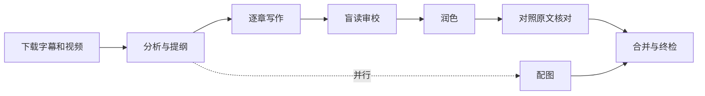

# interview-video-workflow

中文 | [English](README.en.md)

一个 AI 工作流，把 YouTube 上的英文访谈整理成中文访谈长文，支持 Claude Code 和 Codex。

给它一个视频链接，它会依次下载字幕、分析内容、逐章写作、润色中文、对照原文核对、从原视频截图配图，最后输出一篇带截图的 Markdown 长文。

## 目录

- [功能特性](#功能特性)
- [环境要求](#环境要求)
- [快速开始](#快速开始)
- [安装](#安装)
- [使用方法](#使用方法)
- [耗时与额度](#耗时与额度)
- [工作原理](#工作原理)
- [目录结构](#目录结构)
- [更新与卸载](#更新与卸载)
- [常见问题](#常见问题)
- [局限](#局限)
- [致谢](#致谢)

## 功能特性

- **全流程自动化**：下载 → 逐字稿 → 分析提纲 → 写作 → 盲读润色 → 核对 → 配图 → 终检
- **检查内容是否遗漏**：逐字稿的每一段都要登记去向，由脚本核对
- **检查中文质量**：脚本检查翻译腔句式、破折号密度、评判性措辞、编造的神态描写等
- **盲读审校**：交给一个没看过英文原文的 AI 实例审读中文稿，挑出读着不自然的地方
- **原视频配图**：按正文内容从视频里截图，并核对图文是否对得上
- **断点续跑**：中间产物都保存在磁盘上，中断后从没做完的那一步接着做
- **按时长选择做法**：30 分钟以内在一个会话里做完；更长的访谈拆给多个子 agent

## 环境要求

- Windows 10 / 11
- [Claude Code](https://claude.com/claude-code) 或 [Codex](https://openai.com/codex) 桌面版，装一个即可
- Python **3.11 或更高**（脚本用 `python -P` 运行，这个参数从 3.11 才有）、FFmpeg、yt-dlp。这三样由安装脚本自动安装

## 快速开始

1. 下载本仓库，双击 `安装.cmd`
2. 完全退出并重新打开 Claude Code 或 Codex
3. 在助手里打开工作目录（默认是 `文档\访谈长文`），发送：

```
用 interview-video 技能把这个访谈整理成中文长文：https://www.youtube.com/watch?v=xxxxxxxxxxx
```

分析做完后它会停下来给你看提纲，确认后自动做完剩下的步骤。

## 安装

```bash
git clone https://github.com/songyang8964/interview-video-workflow.git
cd interview-video-workflow
```

不用 git 的话，在仓库页面点 **Code → Download ZIP**，下载后解压。

然后运行安装脚本，也可以直接双击 `安装.cmd`：

```powershell
powershell -ExecutionPolicy Bypass -File install.ps1
```

安装脚本会：

1. 检查依赖：Python 3.11+、FFmpeg（缺的用 winget 安装），以及 Python 包 `pillow`、`numpy`
2. 创建工作目录（默认是 `文档\访谈长文`），复制 `tools/`，并下载 `yt-dlp.exe`
3. 检测电脑上装了哪个 AI 助手，把技能复制到 `~/.claude/skills` 和/或 `~/.codex/skills`
4. 在工作目录生成项目规则文件 `CLAUDE.md` / `AGENTS.md`（已有的不会覆盖）
5. 逐项检查，列出已就绪的和还缺的

可选参数：

| 参数 | 说明 | 默认值 |
|---|---|---|
| `-WorkDir` | 工作目录 | `文档\访谈长文` |
| `-Target` | 安装给谁：`auto` / `claude` / `codex` / `both` | `auto` |
| `-SkipDeps` | 跳过依赖安装，只复制文件 | — |

装完后重启 AI 助手，让它加载技能。

## 使用方法

在 Claude Code 或 Codex 里打开工作目录，发送：

```
用 interview-video 技能把这个访谈整理成中文长文：https://www.youtube.com/watch?v=xxxxxxxxxxx
```

在 Claude Code 里也可以用斜杠命令：

```
/interview-video https://www.youtube.com/watch?v=xxxxxxxxxxx
```

默认在分析完成后停一次，给你看提纲；你确认后它会做完剩下的步骤，最后给出一份报告：文章路径、字数、配图数、各项检查结果，以及改动最大的几处的改前改后对照。

### 选项

| 选项 | 说明 |
|---|---|
| `--auto` | 全自动，不在提纲处停 |
| `--deep-polish` | 重点段落改用对抗式打磨（需要 [adversarial-polish](https://github.com/jimliu/illustrated-agent-skills) 技能，安装脚本会自动下载） |
| `<slug>` | 指定这期的文件名，如 `Snowden_JRE1368` |

也可以直接用中文说"全自动""深度润色"。

示例：

```
用 interview-video 技能处理：<链接> --auto
用 interview-video 技能处理：<链接> Snowden_JRE1368 --deep-polish
继续 interview-video 流程：素材\Snowden_JRE1368
```

### 输出

```
访谈长文/
├── <slug>_访谈长文.md          # 成稿
├── <slug>_访谈长文_assets/     # 截图
└── 素材/<slug>/                # 逐字稿、分析素材包、各章草稿、核对记录等中间产物
```

成稿结构：开头（受访者是谁、聊了什么、节目来源和链接）→ 按话题分的若干章，每章 1–2 条中英双语金句 → 结尾 → 文末附注（事实核查、背景补充）→ 复核说明（各步改了多少处、排除了哪些内容、还有哪些没解决）。

成稿是 Markdown，建议用 Typora、Obsidian 或 VS Code 查看。

## 耗时与额度

| 访谈时长 | 做法 | 实测 |
|---|---|---|
| 30 分钟以内 | 一个会话做完，只把盲读和配图交给子 agent | 24 分钟的访谈：约 10 分钟，输入约 160 万 token |
| 30 分钟以上 | 主会话只调度，分析、写作、润色、核对、配图交给子 agent | 用时和用量随时长增加 |

消耗的是你自己 AI 助手的使用额度。下载、字幕整理、截图、格式检查都由脚本完成，不消耗模型额度。数据来源和取舍见 [docs/设计说明.md](docs/设计说明.md)。

## 工作原理



1. **写作、润色、核对分开做**：写作照着中文提纲写，润色只看中文，到核对时才对照英文原文。这样译文不容易贴着英文句式走。
2. **能计数的规则交给脚本**：由 `lint_zh.py` 和 `coverage.py` 检查。成稿必须通过三道闸门：
   - `lint_zh.py --full`：ERROR 为 0，破折号每千字不超过 4 个，开头和结尾都有原始链接
   - `coverage.py`：逐字稿每一段都已登记，没有漏掉的
   - 配图：每张图都核对过原图，`frames.py insert` 每张都找到了唯一的插入位置
3. **盲读隔离**：审读者看不到英文原文。Claude Code 里用独立的子 agent；Codex 里由 `blind_read.ps1` 为每章启动一个独立的 `codex exec` 进程。
4. **按时长选做法**：短访谈的逐字稿不长，一个会话做完更快也更省；长访谈拆给子 agent，免得原文一直占着主会话的上下文。

## 目录结构

```
.
├── 安装.cmd                  # 双击安装
├── install.ps1               # 安装脚本
├── skills/
│   ├── interview-video/      # 主流程（入口）
│   │   └── references/       # 历史错误清单、润色卡、核对卡、配图卡
│   ├── interview-analysis/   # 访谈分析
│   ├── interview-writing/    # 访谈写作（含写作卡、翻译腔对照表）
│   └── writing-style/        # 中文写作风格规范
├── tools/
│   ├── fetch.ps1             # 下载元数据、字幕、视频，生成逐字稿
│   ├── transcript.py         # 把 json3 字幕转成带时间戳的逐字稿
│   ├── lint_zh.py            # 中文质量检查
│   ├── coverage.py           # 逐字稿覆盖与章节密度检查
│   ├── frames.py             # 缩略图拼板、取原帧、插图
│   ├── pack_chapter.py       # 打包每章的写作材料
│   ├── merge.py              # 合并各章和文末附注
│   ├── report.py             # 汇总改动、审读和配图记录
│   ├── blind_read.ps1        # 盲读（Codex 用）
│   └── blind_read_prompt.md
└── docs/
    ├── 设计说明.md
    └── 项目规则.md
```

各脚本单独怎么用，见 [docs/设计说明.md](docs/设计说明.md#脚本单独使用)。

## 更新与卸载

**更新**：`git pull`（或重新下载 ZIP），再运行一次安装脚本。旧版技能会备份到 `~/.claude/skills_backup/<时间>` 或 `~/.codex/skills_backup/<时间>`。工作目录里的 `CLAUDE.md` / `AGENTS.md` 不会被覆盖，如果想用新版规则，先删掉它们再运行安装脚本。

**卸载**：删除技能目录下的 `interview-video`、`interview-analysis`、`interview-writing`、`writing-style`（还有 `adversarial-polish`，如果别的地方没用到它）。工作目录里是你的文章，需要的话自己删除。

## 常见问题

**提示没有 winget**
在 Microsoft Store 里安装或更新"应用安装程序"，然后重新运行安装脚本。

**提示 Python 版本太旧，或者报 `unknown option -P`**
命令行里的 `python` 低于 3.11。卸载旧版本，或者在系统 PATH 里把新版 Python 排到前面，然后重新打开 PowerShell 运行安装脚本。

**AI 助手找不到 interview-video 技能**
确认已经完全退出并重新打开了 AI 助手。检查 `~/.claude/skills/interview-video` 或 `~/.codex/skills/interview-video` 是否存在，不存在就重新运行安装脚本。

**视频下载失败**
先运行 `tools\yt-dlp.exe -U` 更新 yt-dlp。还是不行的话，让助手下载时加上 `-CookiesFrom chrome`。如果 yt-dlp 的报错里提到需要 JavaScript 运行时（JS runtime），按它提示的方式安装，比如 `winget install DenoLand.Deno`，再重试。

**插图时提示"锚点不唯一"或"找不到锚点"**
配图计划里某张图的 `anchor` 在正文中出现了多次，或者正文改过之后已经找不到了。让助手把它换成正文里只出现一次的一段原文，再运行 `frames.py insert`。

**任务中断**
发送 `继续 interview-video 流程：素材\<slug>`，它会从没做完的那一步接着做。

**Codex 盲读提示模型不支持**
给 `blind_read.ps1` 换一个模型，如 `-Model gpt-5.6-terra`。

## 局限

- YouTube 自动字幕不区分说话人，说话人只能靠上下文判断，可能判断错
- 意思译反、说话人张冠李戴这类问题，脚本查不出来，只能靠逐句核对。重要的稿子建议人工抽查
- 单机位或视频连线的访谈，能用的画面不多
- 运行会消耗你 AI 助手的使用额度，访谈越长用得越多

## 致谢

- `interview-analysis`、`interview-writing`、`writing-style` 在 [jimliu/illustrated-agent-skills](https://github.com/jimliu/illustrated-agent-skills) 的基础上扩展
- 取帧和画质检查代码移植自 [video-notes](https://github.com/songyang8964/video-notes)
- 视频下载使用 [yt-dlp](https://github.com/yt-dlp/yt-dlp)
