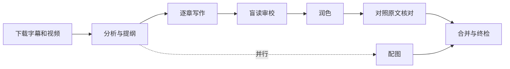

# interview-video-workflow

中文 | [English](README.en.md)

一个 AI 工作流，把 YouTube 上的英文访谈整理成读起来像中文作者写的长文，并配上原视频截图。支持 Claude Code 和 Codex。

你只需要在 AI 助手里贴一个视频链接。它会依次下载字幕、分析内容、逐章写作、润色中文、对照原文核对、从视频里截图配图，最后交给你一篇 Markdown 长文和一份检查报告。

## 目录

- [效果示例](#效果示例)
- [功能特性](#功能特性)
- [环境要求](#环境要求)
- [快速开始](#快速开始)
- [安装](#安装)
- [使用方法](#使用方法)
- [每一步产生什么](#每一步产生什么)
- [耗时与额度](#耗时与额度)
- [工作原理](#工作原理)
- [目录结构](#目录结构)
- [更新与卸载](#更新与卸载)
- [常见问题](#常见问题)
- [局限](#局限)

## 效果示例

机器翻译和一般的 AI 总结，常见三个毛病：句子贴着英文走；最尖锐的段落被悄悄略过；编辑忍不住替读者下判断。这套工作流就是针对这三点做的。下面是实际改稿时的几个例子：

| 直译 | 这里的写法 |
|---|---|
| 他的叙事起点是二战结束后的英国 | 洛从二战结束后的英国讲起 |
| 被误导的利他主义 | 好心办坏事的利他主义 |
| 这一工程的下游后果 | 这一系列政策造成的后果 |
| 我变成了可选项 | 已经可以没有我了 |

内容一段都不漏：逐字稿的每一段都要登记去向，要么写进了文章，要么写明因为是广告、寒暄才没写，再由脚本逐段核对。受访者的说法和公开资料有出入时，在文末附注里说明，正文不插话。

实测一段 24 分钟的访谈：约 10 分钟跑完，得到一篇 6,500 字、3 章、配 3 张截图的长文，外加文末附注和复核说明。

## 功能特性

- **全流程自动化**：下载 → 逐字稿 → 分析提纲 → 写作 → 盲读润色 → 核对 → 配图 → 终检
- **检查内容是否遗漏**：逐字稿每一段都要登记去向，由脚本核对
- **检查中文质量**：脚本检查翻译腔句式、破折号密度、评判性措辞、编造的神态描写等
- **盲读审校**：交给一个没看过英文原文的 AI 审读中文稿，挑出读着不自然的地方
- **保护原话**：受访者自己用的比喻、例子和金句单独列成清单，润色时只改措辞，不许删
- **原视频配图**：按正文内容从视频里截图，并核对图注写的内容画面上真的有
- **断点续跑**：中间产物都存在磁盘上，额度用完、窗口关了，都能从没做完的那一步接着做
- **按时长选择做法**：30 分钟以内在一个会话里做完；更长的访谈拆给多个子 agent

## 环境要求

| 需要什么 | 说明 |
|---|---|
| 系统 | Windows 10 / 11 |
| AI 助手（任选一个，并登录账号） | **Claude**：Claude 桌面版里的 Code 功能，或命令行版 [Claude Code](https://claude.com/claude-code)<br>**Codex**：[Codex](https://openai.com/codex) 桌面版 |
| 网络 | 能访问 YouTube 和 GitHub（下载视频、yt-dlp 和一个可选技能） |
| 磁盘 | 每期访谈约几百 MB（720p 视频，做完可以删） |
| 软件 | Python **3.11 或更高**、FFmpeg、yt-dlp。**不用自己装**，安装脚本会装好 |

Python 版本要求来自脚本的运行方式 `python -P`，这个参数从 3.11 才有。

## 快速开始

**1. 下载。** 在本页面上方点绿色的 **Code** 按钮，选 **Download ZIP**，解压到任意位置。

**2. 安装。** 双击解压出来的 `安装.cmd`。
- 它会装好需要的软件，在"文档"里建一个 `访谈长文` 文件夹，并把写作规则装进你的 AI 助手
- 中途弹出"你要允许此应用对你的设备进行更改吗"，点"是"
- 最后每一项都显示 `[好]` 就装好了；有 `[缺]` 的话，按提示处理后关掉窗口，再双击一次

**3. 开写。** 完全退出你的 AI 助手（在任务栏右下角的图标上右键退出，只关窗口不算），重新打开，打开 `文档\访谈长文` 文件夹，然后发一句：

```
用 interview-video 技能把这个访谈整理成中文长文：https://www.youtube.com/watch?v=xxxxxxxxxxx
```

接下来会发生什么，见[第一次运行](#第一次运行)。

## 安装

### 用安装脚本（推荐）

用 git 下载：

```bash
git clone https://github.com/songyang8964/interview-video-workflow.git
cd interview-video-workflow
```

然后双击 `安装.cmd`，或在 PowerShell 里运行：

```powershell
powershell -ExecutionPolicy Bypass -File install.ps1
```

安装脚本分五步，每一步都会在窗口里显示进度：

1. **检查依赖**：Python 3.11+、FFmpeg，缺的用 winget 安装；再装 Python 包 `pillow`、`numpy`
2. **准备工作文件夹**（默认 `文档\访谈长文`）：复制 `tools\`，下载 `yt-dlp.exe`
3. **安装技能**：检测电脑上装了哪个 AI 助手，把技能复制到 `~/.claude/skills` 和/或 `~/.codex/skills`；同名的旧版本会先备份。另外下载深度润色用的 `adversarial-polish`，下载失败不影响正常使用
4. **生成项目规则**：在工作文件夹写入 `CLAUDE.md`（Claude 读）/ `AGENTS.md`（Codex 读），已有的不覆盖
5. **检查结果**：逐项显示 `[好]` 或 `[缺]`，以及缺了怎么办

安装脚本可以重复运行，已经装好的部分会跳过。

可选参数：

| 参数 | 说明 | 默认值 |
|---|---|---|
| `-WorkDir` | 工作文件夹 | `文档\访谈长文` |
| `-Target` | 装给谁：`auto`（检测到哪个装哪个）/ `claude` / `codex` / `both` | `auto` |
| `-SkipDeps` | 跳过依赖安装，只复制文件 | — |

例如把工作文件夹放到 D 盘、只装给 Claude：

```powershell
powershell -ExecutionPolicy Bypass -File install.ps1 -WorkDir "D:\访谈长文" -Target claude
```

### 手动安装

安装脚本跑不通时（比如公司电脑没有 winget），可以手动完成同样的几件事：

1. 安装 [Python 3.11+](https://www.python.org/downloads/)（安装时勾选 "Add python.exe to PATH"）和 [FFmpeg](https://www.gyan.dev/ffmpeg/builds/)（把 `bin` 目录加入 PATH），然后运行 `python -m pip install --user pillow numpy`
2. 新建工作文件夹，把仓库里的 `tools\` 整个复制进去；从 [yt-dlp 发布页](https://github.com/yt-dlp/yt-dlp/releases/latest)下载 `yt-dlp.exe`，放进工作文件夹的 `tools\`
3. 把仓库 `skills\` 下的四个文件夹复制到 `%USERPROFILE%\.claude\skills\`（Codex 是 `%USERPROFILE%\.codex\skills\`），再把这些文件夹里所有 `.md` 文件中的 `<技能目录>` 替换成上面这个技能目录的完整路径
4. 把 `docs\项目规则.md` 复制到工作文件夹，改名为 `CLAUDE.md`（Codex 用 `AGENTS.md`）

## 使用方法

### 第一次运行

在 AI 助手里打开工作文件夹，发送：

```
用 interview-video 技能把这个访谈整理成中文长文：https://www.youtube.com/watch?v=xxxxxxxxxxx
```

在 Claude Code 里也可以用斜杠命令 `/interview-video <链接>`。

之后的过程：

1. **下载**（约 1–3 分钟）：助手先查视频的标题、频道和时长，再下载字幕和视频。这时它会请你允许运行命令、访问网络，点允许。
2. **分析，然后停下来等你确认**：助手通读逐字稿，给你看一份提纲，包括：
   - 打算分几章，每章的标题和对应的时间段
   - 每章讲哪几个要点
   - 哪些人名、术语的译法拿不准
   - 哪些地方分不清是谁在说话

   没问题就回"确认"。想改就直接说，比如"第二章和第三章合并""Lowe 译成洛"。
3. **写作、润色、核对、配图**：这一段自动完成，不需要你操作。配图在分析完成后就在后台开始，和写作同时进行。
4. **报告**：结束时你会收到一份报告，包括：
   - 文章路径、字数、配图张数
   - 三道检查（中文质量、内容覆盖、配图核对）是否通过，附具体数字
   - 核对时改正了哪些地方
   - 改动最大的 5 处修改前后对比，几分钟就能抽查完

不想在提纲处停，就在那句话末尾加上 `--auto`，提纲会在最后和报告一起给你。

### 常用说法

| 想做什么 | 发这句 |
|---|---|
| 全程不停 | `用 interview-video 技能处理：<链接> --auto` |
| 润色得更细（多花一些额度） | `用 interview-video 技能处理：<链接> --deep-polish` |
| 自己定文件名 | `用 interview-video 技能处理：<链接> Snowden_JRE1368` |
| 中途断了，接着做 | `继续 interview-video 流程：素材\Snowden_JRE1368` |
| 给写好的文章再挑一遍毛病 | `对 素材\Snowden_JRE1368 再做一遍盲读挑刺，合理的意见改进文章，然后重跑三道闸门` |
| 只改某一章 | `改 素材\Snowden_JRE1368 第 2 章：……，改完重新合并、插图并重跑三道闸门` |
| 非英文访谈 | `用 interview-video 技能处理：<链接>，原视频是德语` |

`--auto` 这类开关是写给 AI 看的，直接用中文说"全自动跑完""深度润色"也一样。

### 选项

| 选项 | 说明 |
|---|---|
| `--auto` | 全自动，不在提纲处停 |
| `--deep-polish` | 盲读挑出的段落和开头、结尾，改用对抗式打磨（需要 [adversarial-polish](https://github.com/jimliu/illustrated-agent-skills) 技能，安装脚本会自动下载） |
| `<slug>` | 这期的英文短名，用作文件名。不填时默认 `受访者_节目_期号` |

### 查看和分享成品

成品在工作文件夹里：

```
访谈长文\
├── Snowden_JRE1368_访谈长文.md          文章
├── Snowden_JRE1368_访谈长文_assets\     文章里的截图
└── 素材\Snowden_JRE1368\                逐字稿、分析和检查记录，一般不用管
```

文章是 Markdown 格式。用 [Typora](https://typora.io/)、[Obsidian](https://obsidian.md/) 或 [VS Code](https://code.visualstudio.com/) 打开能看到图片，用记事本只能看到文字。发给别人时，要把文章和同名的 `_assets` 文件夹一起带上。

文章的结构：

1. **开头**：受访者是谁、聊了什么、节目来源（节目名、日期、原视频链接）
2. **正文**：按话题分成若干章。小标题直接写出这一章的结论；每章 1–2 条中英双语金句
3. **结尾**：平实收住，附原视频链接
4. **文末附注**：事实核查和背景补充。受访者的说法和公开资料有出入的，在这里说明
5. **复核说明**：润色、盲读、核对各改了多少处，排除了哪些内容，还有哪些没解决

### 自己修改文章

文章是由 `素材\<slug>\chapters\` 下的各章文件合并出来的。之后只要重新合并（比如让助手改某一章），合并结果就会覆盖成稿，你直接在成稿上做的修改不会保留。上一版成稿会另存为 `<slug>_访谈长文.上一版.md`，但只保留一份。

所以：

- 还要让助手修改的话，改动交给助手，它会改章节文件再重新合并
- 你自己的最后润色，放在助手全部改完之后再做

## 每一步产生什么

每一步的产物都存在 `素材\<slug>\` 下。断点续跑就是靠这张表：已经存在的产物直接跳过，从第一个缺失的那一步接着做。

| 步骤 | 做什么 | 产物 |
|---|---|---|
| 1 下载 | 下载元数据、字幕、720p 视频，整理成带时间戳的逐字稿（30–60 秒一段） | `source.info.json`、`source.*.json3`、`video.mp4`、`transcript.md` |
| 2 分析 | 提炼要点、金句、原话清单，划分章节，统一译名 | `分析素材包.md`、`译名表.md` |
| 3 写作 | 按提纲逐章写，写完跑中文检查 | `chapters\01.md`、`02.md`… |
| 4 盲读与润色 | 没看过英文的 AI 挑毛病，再按意见润色 | `盲读\`、`润色记录*.json` |
| 5 核对 | 逐段对照英文，登记每段去向，改正走样和偏向 | `核对\覆盖表*.csv`、`核对\审查*.md` |
| 6 配图 | 看缩略图拼板选画面，取原图，核对图文 | `配图计划.json`、`<slug>_访谈长文_assets\` |
| 7 终稿 | 写附注和复核说明，合并、插图，跑三道闸门 | `文末附注.md`、成稿、`lint.json` |

## 耗时与额度

| 访谈时长 | 做法 | 实测 |
|---|---|---|
| 30 分钟以内 | 一个会话做完，只把盲读和配图交给子 agent | 24 分钟的访谈：约 10 分钟，输入约 160 万 token |
| 30 分钟以上 | 主会话只调度，分析、写作、润色、核对、配图交给子 agent | 用时和用量随时长增加 |

消耗的是你自己 AI 助手的使用额度。下载、字幕整理、截图、格式检查都由脚本完成，不消耗模型额度。长访谈建议在额度充足时开始；额度中途用完也没关系，等恢复后发"继续 interview-video 流程：素材\<slug>"即可。数据来源和取舍见 [docs/设计说明.md](docs/设计说明.md)。

## 工作原理



1. **写、改、查分成三步，各看各的材料**：写作照着中文要点写，英文只用来查数字和人名；润色只看中文；核对时才逐句对照英文，只管有没有漏、有没有走样。一边对着英文一边写，句子就会贴着英文结构走，这是翻译腔的主要来源。
2. **能计数的规则交给脚本**：写在提示词里的规则，模型未必照做。所以能计数的都写成了脚本，由 `lint_zh.py` 和 `coverage.py` 检查。成稿必须通过三道闸门：
   - `lint_zh.py --full`：ERROR 为 0，破折号每千字不超过 4 个，开头和结尾都有原始链接，文末有复核说明
   - `coverage.py`：逐字稿每一段都已登记，排除的都写了理由
   - 配图：每张图都核对过原图，`frames.py insert` 每张都找到了唯一的插入位置
3. **盲读隔离**：审读者看不到英文原文。Claude Code 里用独立的子 agent；Codex 里由 `blind_read.ps1` 为每章启动一个独立的 `codex exec` 进程。
4. **规则来自返工记录**：此前十几篇长文里被指出、导致返工的问题，整理在 [历史错误清单](skills/interview-video/references/历史错误清单.md) 里，每一条都对应流程里的一道检查。
5. **按时长选做法**：短访谈的逐字稿不长，一个会话做完更快也更省；长访谈拆给子 agent，免得几万字的原文一直占着主会话的上下文。

更多设计取舍见 [docs/设计说明.md](docs/设计说明.md)。

## 目录结构

```
.
├── 安装.cmd                  # 双击安装
├── install.ps1               # 安装脚本
├── skills/                   # 写作规则，安装时装进 AI 助手
│   ├── interview-video/      # 主流程（入口）
│   │   └── references/       # 历史错误清单、润色卡、核对卡、配图卡
│   ├── interview-analysis/   # 访谈分析
│   ├── interview-writing/    # 访谈写作（含写作卡、翻译腔对照表）
│   └── writing-style/        # 中文写作风格规范
├── tools/                    # 脚本，安装时复制到工作文件夹
│   ├── fetch.ps1             # 下载元数据、字幕、视频，生成逐字稿
│   ├── transcript.py         # 把 json3 字幕转成带时间戳的逐字稿
│   ├── lint_zh.py            # 中文质量检查
│   ├── coverage.py           # 逐字稿覆盖与章节密度检查
│   ├── frames.py             # 缩略图拼板、取原帧、插图
│   ├── pack_chapter.py       # 打包每章的写作材料
│   ├── merge.py              # 合并各章和文末附注
│   ├── report.py             # 汇总改动、审读和配图记录
│   ├── blind_read.ps1        # 盲读（Codex 用）
│   └── blind_read_prompt.md
└── docs/
    ├── 设计说明.md            # 设计取舍和脚本单独用法
    └── 项目规则.md            # 安装时写进工作文件夹的 CLAUDE.md / AGENTS.md
```

各脚本单独怎么用，见 [docs/设计说明.md](docs/设计说明.md#脚本单独使用)。

## 更新与卸载

**更新**：`git pull`（或重新下载 ZIP），再运行一次安装脚本。旧版技能会备份到 `~/.claude/skills_backup/<时间>` 或 `~/.codex/skills_backup/<时间>`。工作文件夹里的 `CLAUDE.md` / `AGENTS.md` 不会被覆盖，如果想用新版规则，先删掉它们再运行安装脚本。

**卸载**：删除技能目录下的 `interview-video`、`interview-analysis`、`interview-writing`、`writing-style`（还有 `adversarial-polish`，如果别的地方没用到它）。工作文件夹里是你的文章，需要的话自己删除。

## 常见问题

### 安装

**双击 `安装.cmd` 后提示没有 winget**
打开 Microsoft Store，搜索"应用安装程序"，安装或更新后再双击一次。

**提示 Python 版本太旧，或者运行时报 `unknown option -P`**
命令行里的 `python` 低于 3.11。卸载旧版本，或者在系统 PATH 里把新版 Python 排到前面，然后重新打开 PowerShell 运行安装脚本。

**装完 Python 或 FFmpeg 后，检查结果还是 `[缺]`**
新装的程序要重新打开窗口才找得到。关掉窗口，再双击一次 `安装.cmd`。

**助手说找不到 interview-video 技能**
先确认是从任务栏右下角完全退出后重新打开的。再检查 `~/.claude/skills/interview-video` 或 `~/.codex/skills/interview-video` 是否存在，不存在就再运行一次安装脚本。

### 运行

**视频下载失败**
- 对助手说"更新 yt-dlp 后重试"
- 还不行就说"下载时加上 -CookiesFrom chrome"，借用 Chrome 里的 YouTube 登录状态（年龄限制、会员视频也需要这样做）
- 如果报错里提到需要 JavaScript 运行时（JS runtime），按提示安装，比如 `winget install DenoLand.Deno`，再重试
- 视频实在下不了，可以说"先只下载字幕开始写"，配图前再下载视频

**额度用完了，或者窗口被关了**
做完的部分都存在磁盘上。重新打开助手，发"继续 interview-video 流程：素材\这期的文件名"，会从断开的地方接着做。

**插图时提示"锚点不唯一"或"找不到锚点"**
配图计划里某张图的插入位置（`anchor`）在正文里出现了多次，或者正文改过之后找不到了。让助手把它换成正文里只出现一次的一段原文，再重新插图。

**Codex 提示"模型不支持"**
对它说"盲读改用 gpt-5.6-terra 模型重跑"。

### 结果

**图打不开，或者文章里只显示图片路径**
用 Typora、Obsidian 或 VS Code 打开，并确认 `_assets` 文件夹和文章在同一个目录。

**对某处翻译有疑问**
对助手说"第 2 章'……'这句，原话是怎么说的"，它会按时间点去逐字稿里查。

## 局限

- YouTube 自动字幕不标谁在说话，只能靠上下文判断。拿不准的地方会专门核对，但仍可能出错
- 意思译反、张冠李戴这类错误，脚本查不出来，只能靠逐句对照。重要的文章建议自己抽查几段
- 视频连线、全程只有一个镜头的访谈，能用的画面很少，通常每章只配一张图
- 运行会消耗你 AI 助手的使用额度，访谈越长用得越多
- 目前只支持 Windows
