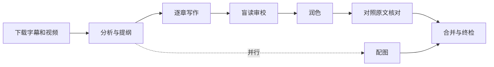

# interview-video-workflow

中文 | [English](README.en.md)

**把 YouTube 英文访谈变成一篇读起来像中文作者写的长文，配上原视频截图。**

在 Claude Code 或 Codex 里贴一个视频链接，AI 会自动下载字幕、写作、润色、对照原文核对、截图配图，最后交给你一篇带截图的 Markdown 文章和一份检查报告。

 

## 目录

- [简介](#简介)
- [效果示例](#效果示例)
- [功能特性](#功能特性)
- [快速开始](#快速开始)
- [使用方法](#使用方法)
- [更新与卸载](#更新与卸载)
- [常见问题](#常见问题)
- [局限](#局限)
- [开发者参考](#开发者参考)

## 简介

直接让 AI "把这期访谈翻译成中文文章"，通常也能得到一篇读得下去的文章，但有几个问题很难靠读一遍发现：

1. **读着像翻译。** 句子贴着英文结构走，习语按字面译。每句话都看得懂，连起来就是不像中文。
2. **内容被概括或跳过。** 访谈一长，AI 常把一些段落压成一句概括，或者直接跳过，再用一句过渡把前后接上。文章照样通顺，不对照原视频就看不出缺了东西。
3. **加进原话里没有的东西。** 比如编出视频里没有的"他笑着说""他停了一下"。
4. **意思出错。** 否定句被译反，说话人弄混。

只在提示词里叮嘱"不要遗漏""不要翻译腔"，AI 未必照做。这个项目把整理过程拆成几个独立的步骤，每一步都有专门的检查，检查不通过就不算完成。比如：

- 逐字稿的每一段都要登记"写进了哪一章"，或者写明为什么不写（广告、寒暄），由程序逐段核对，漏一段都会被拦下
- 写好的中文交给一个**没看过英文原文**的 AI 通读，专挑读着像翻译、看不懂的地方
- 最后再逐句对照英文，查有没有译错、有没有说话人弄混

你不需要了解这些步骤怎么运作。AI 会自己跑完，最后告诉你每项检查的结果。

## 效果示例

实际改稿时的几处对照：

| 英文原话 | 直译 | 这个工作流写成 |
|---|---|---|
| a fly on the wall | 墙上的一只苍蝇 | 在旁边悄悄看着 |
| I've become optional | 我变成了可选项 | 已经可以没有我了 |
| misguided altruism | 被误导的利他主义 | 好心办坏事的利他主义 |
| at peace with itself | 完全与自身和平共处的国家 | 安居乐业、人人互信的社会 |
| born on second base | 从二垒起跑 | 一出生就占了先机 |
| fall in line | 乖乖排好队 | 乖乖照做 |
| It's a slippery slope | 这是一个滑坡 | 口子一开就收不住 |
| downstream consequences | 这一工程的下游后果 | 这一系列政策造成的后果 |
| physical report | 一份实体报告 | 一份纸质报告 |

长段口语也不会整段塞进引号：

- 直译：他说："我认为，嗯，你知道，这件事情的问题在于，如果你看一下数据，你会发现它其实并不是人们所想的那样。"
- 改写：他认为，只要看看数据就会发现，事情"并不是大家想的那样"。

**实测**：一段 24 分钟的访谈，约 10 分钟跑完，得到一篇 6,500 字、3 章、配 3 张截图的长文。

**成品的结构**：

1. **开头**：受访者是谁、聊了什么、节目来源（节目名、日期、原视频链接）
2. **正文**：按话题分成若干章，小标题直接写出这一章的结论。每章 1–2 句中英对照的金句
3. **结尾**：附原视频链接
4. **文末附注**：背景补充和事实核查。受访者的说法和公开资料有出入的，在这里说明
5. **复核说明**：润色、核对各改了多少处，有哪些内容没写进正文、为什么

## 功能特性

- **一句话启动**：贴一个链接，下载、写作、润色、核对、配图自动完成
- **中途确认提纲**：分析完先给你看章节划分和拿不准的译名，确认后再写；也可以全自动不停
- **不漏内容**：访谈的每一段都要有去向，漏写会被拦下
- **不像翻译**：由没看过英文的 AI 挑刺，再按规则检查常见的翻译腔句式
- **保护原话**：受访者自己用的比喻、例子和金句会单独列出来，润色时只改措辞，不许删
- **原视频配图**：按内容从视频里截图，并核对图注写的内容画面上真的有
- **断点续跑**：额度用完、窗口关了，都能从没做完的地方接着做
- **省额度**：下载、截图、格式检查都由本地程序完成，不消耗 AI 额度

## 快速开始

### 准备

- 一台 Windows 10 / 11 电脑，能访问 YouTube 和 GitHub
- 装好下面任意一个 AI 助手，并登录账号：
  - **Claude**：[Claude 桌面版](https://claude.com/download)（使用其中的 Code 功能），或命令行版 [Claude Code](https://claude.com/claude-code)
  - **Codex**：[Codex](https://openai.com/codex) 桌面版

其他需要的软件（Python、FFmpeg、yt-dlp）由安装程序自动装好，不用自己准备。

### 第 1 步：安装

**方式一：双击安装（推荐）**

1. 在本页面上方点绿色的 **Code** 按钮，选 **Download ZIP**，解压到任意位置
2. 双击解压出来的 `安装.cmd`
3. 中途弹出"你要允许此应用对你的设备进行更改吗"，点"是"
4. 等窗口里每一项都显示 `[好]`，就装好了。如果有 `[缺]`，按它的提示处理，然后关掉窗口再双击一次

**方式二：让 AI 助手帮你装**

如果你已经在用 Claude Code 或 Codex，可以直接把下面这段话发给它：

```
请帮我安装 https://github.com/songyang8964/interview-video-workflow ：
把仓库下载到本地，然后运行里面的 install.ps1（powershell -ExecutionPolicy Bypass -File install.ps1），
装完把检查结果里显示 [缺] 的项目告诉我。
```

安装程序会在"文档"里建一个 `访谈长文` 文件夹，以后的文章都放在这里。

### 第 2 步：重启 AI 助手

**完全退出**你的 AI 助手（在任务栏右下角的图标上右键退出，只关窗口不算），再重新打开。这样它才会加载新装的写作规则。

### 第 3 步：开始第一篇

在 AI 助手里打开 `文档\访谈长文` 文件夹，发一句：

```
用 interview-video 技能把这个访谈整理成中文长文：https://www.youtube.com/watch?v=xxxxxxxxxxx
```

接下来会发生什么，见[第一次运行](#第一次运行)。

## 使用方法

### 第一次运行

**① 下载（约 1–3 分钟）。** 助手先查视频的标题、频道和时长，再下载字幕和视频。这时它会请你允许运行命令、访问网络，点允许。

**② 分析，然后停下来等你确认。** 助手读完整期访谈后，会给你看一份提纲，大致是这样（示意）：

```
**一、手机关着屏，也一直在喊"我在这里"** [00:00:00–00:07:59]
  - 要点 1 ……
  - 要点 2 ……
**二、……** [00:08:00–00:19:30]
  ……

译名拿不准：Smith 译作"史密斯"还是"斯密"？
说话人存疑：00:12:40 这段像是主持人在转述别人的话
```

没问题就回"确认"。想改就直接说，比如"第二章和第三章合并""Smith 译成史密斯"。

**③ 写作、润色、核对、配图。** 这一段自动完成，不需要你操作。

**④ 报告。** 结束时你会收到一份报告：

- 文章在哪、多少字、配了几张图
- 三项检查是否都通过：中文有没有翻译腔、内容有没有漏、配图对不对
- 核对时改正了哪些地方
- 改动最大的 5 处修改前后对比，几分钟就能抽查一遍

不想在提纲处停，就在那句话末尾加上 `--auto`，提纲会在最后和报告一起给你。

### 常用说法

直接复制这些话发给助手，把 `<链接>`、`<文件名>` 换成你自己的：

| 想做什么 | 发这句 |
|---|---|
| 全程不停 | `用 interview-video 技能处理：<链接> --auto` |
| 润色得更细（多花一些额度） | `用 interview-video 技能处理：<链接> --deep-polish` |
| 自己定文件名 | `用 interview-video 技能处理：<链接> 文件名用 JaneDoe_Podcast_12` |
| 中途断了，接着做 | `继续 interview-video 流程：素材\<文件名>` |
| 再挑一遍毛病 | `对 素材\<文件名> 再做一遍盲读挑刺，合理的意见改进文章，然后重跑三道闸门` |
| 只改某一章 | `改 素材\<文件名> 第 2 章：……，改完重新合并、插图并重跑三道闸门` |
| 查某句话的原文 | `第 2 章"……"这句，原话是怎么说的？` |
| 觉得某章写薄了 | `第 3 章对照原文补全，漏掉的论点和例子都写进去` |
| 非英文访谈 | `用 interview-video 技能处理：<链接>，原视频是德语` |

- "三道闸门"就是报告里那三项检查，"盲读挑刺"就是让没看过英文的 AI 再读一遍。这些是助手认识的说法，照抄即可
- `--auto` 这类开关也可以直接用中文说，比如"全自动跑完""深度润色"
- `<文件名>` 是这期访谈的英文短名，比如 `JaneDoe_Podcast_12`，在报告里和 `素材` 文件夹里都能看到（见下一节）

### 查看和分享成品

成品在 `访谈长文` 文件夹里：

```
访谈长文\
├── <文件名>_访谈长文.md          文章
├── <文件名>_访谈长文_assets\     文章里的截图
└── 素材\<文件名>\                中间过程的记录，一般不用管
```

`<文件名>` 是这期访谈的英文短名。你不指定的话，助手会按"受访者_节目_期号"自动起一个，比如受访者 Jane Doe 上了某播客第 12 期，文件名就是 `JaneDoe_Podcast_12`，文章就叫 `JaneDoe_Podcast_12_访谈长文.md`。

- 用 [Typora](https://typora.io/)、[Obsidian](https://obsidian.md/) 或 [VS Code](https://code.visualstudio.com/) 打开文章，能看到图片；用记事本只能看到文字
- 发给别人时，要把文章和同名的 `_assets` 文件夹一起带上，否则图片显示不出来
- 视频文件在 `素材` 里，每期几百 MB，文章写完可以删掉

### 自己修改文章

如果还要让助手改，就把要改的地方告诉它，不要自己先改文章文件。因为助手每次修改后会重新生成整篇文章，你直接在文章里改的内容会被覆盖（上一版会另存为 `.上一版.md`，但只保留一份）。

你自己的最后润色，放在助手全部改完之后再做。

### 耗时与额度

| 访谈时长 | 大约耗时 | 说明 |
|---|---|---|
| 30 分钟以内 | 10 分钟左右（实测 24 分钟的访谈约 10 分钟） | 一个对话从头做到尾 |
| 30 分钟以上 | 随时长增加 | 拆给多个子任务分头做 |

消耗的是你自己 AI 助手的使用额度，访谈越长用得越多。长访谈建议在额度充足时开始；中途用完也没关系，额度恢复后发"继续 interview-video 流程：素材\<文件名>"即可。

## 更新与卸载

**更新**：重新下载 ZIP（或 `git pull`），再双击一次 `安装.cmd`。旧版写作规则会自动备份。`访谈长文` 文件夹里的 `CLAUDE.md` / `AGENTS.md` 不会被覆盖，想用新版的话先删掉它们再安装。

**卸载**：删除 `%USERPROFILE%\.claude\skills\`（Codex 是 `%USERPROFILE%\.codex\skills\`）下的 `interview-video`、`interview-analysis`、`interview-writing`、`writing-style` 四个文件夹。`访谈长文` 文件夹里是你的文章，需要的话自己删。

## 常见问题

### 安装

**双击 `安装.cmd` 后提示没有 winget**
打开 Microsoft Store，搜索"应用安装程序"，安装或更新后再双击一次。

**提示 Python 版本太旧**
电脑上已有的 Python 低于 3.11。卸载旧版本后，再双击一次 `安装.cmd`。

**装完了，检查结果还是显示 `[缺]`**
新装的软件要重新打开窗口才认得出来。关掉窗口，再双击一次 `安装.cmd`。

**助手说找不到 interview-video 技能**
确认是从任务栏右下角完全退出后重新打开的。还不行就再双击一次 `安装.cmd`。

### 运行

**视频下载失败**
按顺序试：

1. 对助手说"更新 yt-dlp 后重试"
2. 说"下载时加上 -CookiesFrom chrome"，借用 Chrome 里的 YouTube 登录状态（有年龄限制或会员专属的视频也要这样）
3. 如果报错里提到需要 JavaScript 运行时（JS runtime），对助手说"按报错提示装好 JS 运行时再重试"
4. 视频实在下不了，说"先只下载字幕开始写"，配图前再下载视频

**额度用完了，或者窗口被关了**
做完的部分都保存着。重新打开助手，发"继续 interview-video 流程：素材\<文件名>"，会从断开的地方接着做。

**报告里说有几张图没插进去**
通常是文章改过之后，原定的插图位置找不到了。对助手说"把没插进去的图重新定位，插到对应的段落"。

**Codex 提示"模型不支持"**
对它说"盲读改用 gpt-5.6-terra 模型重跑"。

### 结果

**文章里图片不显示，只看到一串路径**
用 Typora、Obsidian 或 VS Code 打开，并确认 `_assets` 文件夹和文章在同一个文件夹里。

**对某处翻译有疑问**
对助手说"第 2 章'……'这句，原话是怎么说的"，它会去原始字幕里查。

## 局限

- YouTube 自动字幕不标谁在说话，只能靠上下文判断。拿不准的地方会专门核对，但仍可能出错
- 意思译反、说话人弄混这类错误，只能靠逐句对照发现。重要的文章建议自己抽查几段
- 视频连线、全程只有一个镜头的访谈，能用的画面很少，通常每章只配一张图
- 目前只支持 Windows

## 开发者参考

这一部分写给想了解内部做法、手动安装或修改规则的人。只是使用的话，不用看。

### 手动安装

安装程序跑不通时（比如公司电脑没有 winget），可以手动完成同样的几件事：

1. 安装 [Python 3.11+](https://www.python.org/downloads/)（勾选 "Add python.exe to PATH"）和 [FFmpeg](https://www.gyan.dev/ffmpeg/builds/)（把 `bin` 目录加入 PATH），然后运行 `python -m pip install --user pillow numpy`。脚本用 `python -P` 运行，这个参数从 3.11 才有
2. 新建工作文件夹，把仓库里的 `tools\` 整个复制进去；从 [yt-dlp 发布页](https://github.com/yt-dlp/yt-dlp/releases/latest)下载 `yt-dlp.exe`，放进工作文件夹的 `tools\`
3. 把仓库 `skills\` 下的四个文件夹复制到 `%USERPROFILE%\.claude\skills\`（Codex 是 `%USERPROFILE%\.codex\skills\`），再把这些文件夹里所有 `.md` 文件中的 `<技能目录>` 替换成这个技能目录的完整路径
4. 把 `docs\项目规则.md` 复制到工作文件夹，改名为 `CLAUDE.md`（Codex 用 `AGENTS.md`）

### 安装脚本参数

```powershell
powershell -ExecutionPolicy Bypass -File install.ps1 [-WorkDir <路径>] [-Target auto|claude|codex|both] [-SkipDeps]
```

| 参数 | 说明 | 默认值 |
|---|---|---|
| `-WorkDir` | 工作文件夹 | `文档\访谈长文` |
| `-Target` | 装给谁：`auto`（检测到哪个装哪个）/ `claude` / `codex` / `both` | `auto` |
| `-SkipDeps` | 跳过依赖安装，只复制文件 | — |

安装脚本依次做五件事：检查并安装依赖；准备工作文件夹、复制 `tools\`、下载 `yt-dlp.exe`；把技能复制到 `~/.claude/skills` 和/或 `~/.codex/skills`（旧版先备份到 `skills_backup\<时间>`），并下载深度润色用的 `adversarial-polish`；生成 `CLAUDE.md` / `AGENTS.md`（已有的不覆盖）；最后逐项检查。可以重复运行。

### 工作原理



**写、改、查分成三步，各看各的材料。** 一边对着英文一边写，句子就会贴着英文结构走，这是翻译腔的主要来源。

| 步骤 | 看什么 | 只管什么 |
|---|---|---|
| 写作 | 中文要点，英文只用来查数字、人名 | 把意思写全 |
| 润色 | 只看中文 | 读起来顺不顺 |
| 核对 | 中文对照英文 | 有没有漏、有没有走样 |

**能计数的规则交给脚本。** 成稿必须通过三道闸门：

| 闸门 | 通过条件 |
|---|---|
| `lint_zh.py --full`（中文检查） | ERROR 为 0；破折号每千字不超过 4 个；开头和结尾都有原始链接；文末有复核说明 |
| `coverage.py --article`（覆盖检查） | 逐字稿每一段都已在覆盖表中登记为"写入""合并"或"排除"，排除都写了理由；排除超过全片 8% 或连续超过 3 分钟时要逐句复核；每章"每分钟访谈写成多少字"不到中位数一半的，标为偏薄 |
| 配图核对 | 每张图都打开原图核对过；`frames.py insert` 每张都找到了唯一的插入位置 |

WARN 级别的提示不阻止完成，但要逐条处理：改掉，或写明为什么保留。

**盲读隔离。** 审读者只看中文，看不到英文原文。Claude Code 里用独立的子 agent；Codex 里由 `blind_read.ps1` 为每章启动一个独立的 `codex exec` 进程。审读意见逐条判断，不照单全收：分析时会列出一份"原话清单"，受访者自己的比喻和例子只改措辞，不能删。

**按时长选做法。** 30 分钟以内，一个会话做完，只把盲读和配图交给子 agent；更长的访谈由主会话调度，分析、写作、润色、核对、配图交给子 agent，免得几万字的原文一直占着主会话的上下文。实测数据和取舍见 [docs/设计说明.md](docs/设计说明.md)。

### 每一步的产物

每期的中间产物在 `素材\<文件名>\` 下。断点续跑靠的就是这张表：已经存在的产物直接跳过，从第一个缺失的那一步接着做。

| 步骤 | 做什么 | 产物 |
|---|---|---|
| 1 下载 | 下载元数据、字幕、720p 视频，整理成带时间戳的逐字稿（30–60 秒一段） | `source.info.json`、`source.*.json3`、`video.mp4`、`transcript.md` |
| 2 分析 | 提炼要点、金句、原话清单，划分章节，统一译名 | `分析素材包.md`、`译名表.md` |
| 3 写作 | 按提纲逐章写，写完跑中文检查 | `chapters\01.md`、`02.md`… |
| 4 盲读与润色 | 没看过英文的 AI 挑毛病，再按意见润色 | `盲读\`、`润色记录*.json` |
| 5 核对 | 逐段对照英文，登记每段去向 | `核对\覆盖表*.csv`、`核对\审查*.md` |
| 6 配图 | 看缩略图拼板选画面，取原图，核对图文 | `配图计划.json`、`<文件名>_访谈长文_assets\` |
| 7 终稿 | 写附注和复核说明，合并、插图，跑三道闸门 | `文末附注.md`、成稿、`lint.json` |

### 目录结构

```
.
├── 安装.cmd                  # 双击安装
├── install.ps1               # 安装脚本
├── skills/                   # 写作规则，安装时装进 AI 助手
│   ├── interview-video/      # 主流程（入口）
│   │   └── references/       # 历史错误清单、润色卡、核对卡、配图卡
│   ├── interview-analysis/   # 访谈分析
│   ├── interview-writing/    # 访谈写作（含写作卡、翻译腔对照表）
│   └── writing-style/        # 中文写作风格规范
├── tools/                    # 脚本，安装时复制到工作文件夹
│   ├── fetch.ps1             # 下载元数据、字幕、视频，生成逐字稿
│   ├── transcript.py         # 把 json3 字幕转成带时间戳的逐字稿
│   ├── lint_zh.py            # 中文质量检查
│   ├── coverage.py           # 逐字稿覆盖与章节密度检查
│   ├── frames.py             # 缩略图拼板、取原帧、插图
│   ├── pack_chapter.py       # 打包每章的写作材料
│   ├── merge.py              # 合并各章和文末附注
│   ├── report.py             # 汇总改动、审读和配图记录
│   ├── blind_read.ps1        # 盲读（Codex 用）
│   └── blind_read_prompt.md
└── docs/
    ├── 设计说明.md            # 设计取舍和脚本单独用法
    └── 项目规则.md            # 安装时写进工作文件夹的 CLAUDE.md / AGENTS.md
```

各脚本单独怎么用，见 [docs/设计说明.md](docs/设计说明.md#脚本单独使用)。
