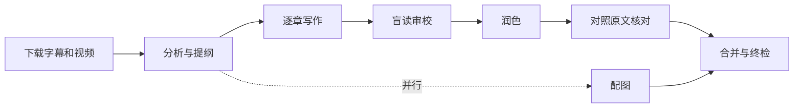

# interview-video-workflow

将 YouTube 英文访谈转换为中文访谈长文的 AI 工作流，支持 Claude Code 和 Codex。

输入一个视频链接，自动完成字幕下载、内容分析、逐章写作、中文润色、忠实度核对和原视频配图，输出一篇带截图的 Markdown 长文。

## 功能特性

- **全流程自动化**：下载 → 逐字稿 → 分析提纲 → 写作 → 盲读润色 → 核对 → 配图 → 终检
- **内容完整性检查**：逐字稿每一段都必须登记去向，脚本自动核对，防止内容被遗漏
- **中文质量检查**：脚本检测翻译腔句式、破折号密度、评判性措辞、编造的神态描写等
- **盲读审校**：由未接触英文原文的 AI 实例审读中文稿，找出不自然的表达
- **原视频配图**：按正文内容从视频中截取画面，并核对图文是否一致
- **断点续跑**：中间产物均保存在磁盘上，中断后从未完成的步骤继续
- **按时长自适应**：30 分钟以内由单个会话完成；更长的访谈拆分给多个子 agent 并行处理

## 环境要求

- Windows 10 / 11
- [Claude Code](https://claude.com/claude-code) 或 [Codex](https://openai.com/codex) 桌面版（任选其一）
- Python 3.11+、FFmpeg、yt-dlp（安装脚本会自动安装）

## 安装

```bash
git clone https://github.com/songyang8964/interview-video-workflow.git
cd interview-video-workflow
```

或在页面上点击 **Code → Download ZIP** 下载并解压。

然后运行安装脚本（也可以直接双击 `安装.cmd`）：

```powershell
powershell -ExecutionPolicy Bypass -File install.ps1
```

安装脚本会：

1. 检查并安装 Python、FFmpeg（通过 winget）和 Python 依赖 `pillow`、`numpy`
2. 创建工作目录（默认为 `文档\访谈长文`），复制 `tools/` 并下载 `yt-dlp.exe`
3. 检测已安装的 AI 助手，将技能复制到 `~/.claude/skills` 和/或 `~/.codex/skills`
4. 在工作目录生成项目规则文件 `CLAUDE.md` / `AGENTS.md`（已存在则不覆盖）

可选参数：

| 参数 | 说明 | 默认值 |
|---|---|---|
| `-WorkDir` | 工作目录 | `文档\访谈长文` |
| `-Target` | 安装目标：`auto` / `claude` / `codex` / `both` | `auto` |
| `-SkipDeps` | 跳过依赖安装，只复制文件 | — |

安装完成后，重启 AI 助手以加载技能。

## 使用方法

在 Claude Code 或 Codex 中打开工作目录，输入：

```
用 interview-video 技能把这个访谈整理成中文长文：https://www.youtube.com/watch?v=xxxxxxxxxxx
```

Claude Code 中也可以使用斜杠命令：

```
/interview-video https://www.youtube.com/watch?v=xxxxxxxxxxx
```

默认情况下，分析完成后会暂停，展示提纲供确认；确认后自动完成剩余步骤，最后输出报告（文章路径、字数、配图数、检查结果、主要修改对照）。

### 选项

| 选项 | 说明 |
|---|---|
| `--auto` | 全自动运行，不在提纲处暂停 |
| `--deep-polish` | 对重点段落使用对抗式打磨（需要 [adversarial-polish](https://github.com/jimliu/illustrated-agent-skills) 技能，安装脚本会自动下载） |
| `<slug>` | 指定文件名，如 `Snowden_JRE1368` |

示例：

```
用 interview-video 技能处理：<链接> --auto
用 interview-video 技能处理：<链接> Snowden_JRE1368 --deep-polish
继续 interview-video 流程：素材\Snowden_JRE1368
```

### 输出

```
访谈长文/
├── <slug>_访谈长文.md          # 成稿
├── <slug>_访谈长文_assets/     # 截图
└── 素材/<slug>/                # 逐字稿、分析素材包、核对记录等中间产物
```

成稿为 Markdown 格式，建议使用 Typora、Obsidian 或 VS Code 查看。

## 工作原理



1. **写作、润色、核对分离**：写作依据中文提纲，润色只看中文，核对时才对照英文原文，避免译文贴着英文句式走。
2. **规则脚本化**：可计数的规则由 `lint_zh.py` 和 `coverage.py` 检查，成稿必须通过三项检查：
   - `lint_zh.py --full`：ERROR 为 0，破折号每千字不超过 4 个
   - `coverage.py`：逐字稿每段均已登记，无漏项
   - 配图：每张图都已核对原图
3. **盲读隔离**：审读者不接触英文原文。Claude Code 中使用独立子 agent，Codex 中通过 `blind_read.ps1` 为每章启动独立的 `codex exec` 进程。
4. **按时长选择模式**：短访谈的逐字稿篇幅小，由单个会话完成更快、更省；长访谈拆分给子 agent，避免原文长期占用主会话上下文。

实测数据与设计取舍见 [docs/设计说明.md](docs/设计说明.md)。

## 目录结构

```
.
├── 安装.cmd                  # 双击安装
├── install.ps1               # 安装脚本
├── skills/
│   ├── interview-video/      # 主流程（入口）
│   │   └── references/       # 历史错误清单、润色卡、核对卡、配图卡
│   ├── interview-analysis/   # 访谈分析
│   ├── interview-writing/    # 访谈写作（含写作卡、翻译腔对照表）
│   └── writing-style/        # 中文写作风格规范
├── tools/
│   ├── fetch.ps1             # 下载元数据、字幕、视频，生成逐字稿
│   ├── transcript.py         # json3 字幕转为带时间戳的逐字稿
│   ├── lint_zh.py            # 中文质量检查
│   ├── coverage.py           # 逐字稿覆盖与章节密度检查
│   ├── frames.py             # 缩略图拼板、取原帧、插图
│   ├── pack_chapter.py       # 打包每章写作材料
│   ├── merge.py              # 合并章节与文末附注
│   ├── report.py             # 汇总修改、审读与配图记录
│   ├── blind_read.ps1        # 盲读（Codex）
│   └── blind_read_prompt.md
└── docs/
    ├── 设计说明.md
    └── 项目规则.md
```

各脚本的单独用法见 [docs/设计说明.md](docs/设计说明.md#脚本单独使用)。

## 常见问题

**提示没有 winget**
在 Microsoft Store 中安装或更新"应用安装程序"，然后重新运行安装脚本。

**AI 助手找不到 interview-video 技能**
确认已完全退出并重启 AI 助手；检查 `~/.claude/skills/interview-video` 或 `~/.codex/skills/interview-video` 是否存在，不存在则重新运行安装脚本。

**视频下载失败**
运行 `tools\yt-dlp.exe -U` 更新 yt-dlp；仍失败时，让助手下载时加上 `-CookiesFrom chrome`。

**任务中断**
发送 `继续 interview-video 流程：素材\<slug>`，从未完成的步骤继续。

**Codex 盲读提示模型不支持**
为 `blind_read.ps1` 指定其他模型，如 `-Model gpt-5.6-terra`。

## 局限

- YouTube 自动字幕不区分说话人，说话人归属依赖上下文判断，可能出错
- 意思译反、说话人错置等问题无法由脚本检测，依赖逐句核对，重要稿件建议人工抽查
- 单机位或视频连线的访谈可用画面有限
- 运行会消耗 AI 助手的使用额度，与访谈时长成正比

## 致谢

- `interview-analysis`、`interview-writing`、`writing-style` 基于 [jimliu/illustrated-agent-skills](https://github.com/jimliu/illustrated-agent-skills) 扩展
- 取帧与画质检查代码移植自 [video-notes](https://github.com/songyang8964/video-notes)
- 视频下载使用 [yt-dlp](https://github.com/yt-dlp/yt-dlp)
