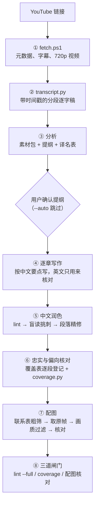

# interview-video-workflow

把 YouTube 英文访谈，变成**忠实、完整、读起来像中文原创、配有原视频画面**的中文访谈长文。

只需提供一个链接：

```
/interview-video https://www.youtube.com/watch?v=xxxx
```

## 流程



默认只在提纲处停一次，等用户确认；加 `--auto` 就全程不停。每一步的产物都存在磁盘上，中断后从缺失的那一步继续。

## 为什么这样设计：写作质量

以往生成的长文有三个毛病：英文直译痕迹明显、语言生硬、写作规范执行不到位。原因和对应的做法如下：

| 原因 | 做法 |
|---|---|
| 风格规范是没填写的模板，"自然中文"无从执行 | `writing-style` 写成具体规则：正反例、翻译腔对照表、禁用清单 |
| 一遍之内既要理解、压缩、组织，又要用中文表达，句子就会贴着英文结构走 | **拆成三步，每步的输入不同**：写作看中文要点；润色只看中文；核对时才对照英文，只管有没有走样 |
| 文章写到十万字，规则早已远在上下文前部；子 agent 也不会自动加载技能 | 用约 40 行的**写作卡**，每章开写前重读；子 agent 的 prompt 模板强制它先读规则文件 |
| 只能靠自觉，没有可以计数的检查 | `lint_zh.py` 机械检查禁用词、评判性措辞、翻译腔句式、破折号密度、长句、长引语、英文残留、每章双语金句数、小标题是否过泛；成稿模式另查开头和结尾的来源链接、文末复核说明 |
| lint 查不出"读着像翻译" | 每章派一个只读中文的子 agent 做**盲读挑刺**，挑出最拗口的段落；只对这些段落和开头、结尾做精修 |
| 并行写作时同一个人在不同章节有不同译名 | 分析阶段产出**译名表**，所有章节照用 |
| "有没有遗漏"只能靠模型自觉 | **覆盖表**：逐字稿每一段都要登记为写入、合并或排除，排除必须写原因；`coverage.py` 检查有没有漏登记，并标出过长的排除 |

需要更高质量时，加 `--deep-polish`：被挑出的段落改用对抗式打磨（[adversarial-polish](https://github.com/jimliu/illustrated-agent-skills/tree/main/skills/adversarial-polish)）。打磨前会写一份访谈实录专用的任务描述：信息不可增删，受访者的表态不可软化，争议内容不得删减。

成稿后列出改动最大的 5 处，附改前和改后，方便你花几分钟抽查润色方向对不对。

## 节省 token，质量不打折

- 下载、字幕整理、截图、画质判断、插图和格式检查都由脚本完成，不消耗模型
- 逐字稿只在分析时通读一遍；之后各步按时间范围只读对应片段
- 主 agent 只负责调度，章节正文写在文件里，不把全文读进上下文
- 子 agent 只拿到规则、本章素材和本章逐字稿片段
- 根据 lint 给出的行号定点修改，不重写整章
- 精修按段落而不是按章：先盲读挑刺，只修被挑出的段落，以及开头和结尾
- 看图先粗后细：先看 30 秒间隔的全片联系表，再看候选时间点附近 3 秒间隔的局部联系表，最后只打开选中的原图

## 目录

```
skills/
  interview-video/       总流程（入口）
  interview-analysis/    访谈分析 → 素材包与提纲
  interview-writing/     访谈实录写作
    references/写作卡.md        硬规则压缩版，每章重读
    references/翻译腔对照表.md   润色时对照
  writing-style/         中文写作风格规范
tools/
  fetch.ps1        下载元数据、字幕和视频，并生成逐字稿
  transcript.py    json3 字幕 → 带时间戳的分段逐字稿
  lint_zh.py       中文质量检查（有 ERROR 时退出码为 1；--full 用于成稿）
  coverage.py      逐字稿逐段覆盖检查（覆盖表.csv）
  frames.py        sheet 联系表 / grab 取原帧并过画质 / insert 按锚点插图
docs/
  项目规则.md      放进访谈长文目录的项目说明（偏向与完整性规则）
```

## 安装

1. 准备依赖：Python 3.11+、FFmpeg、[yt-dlp](https://github.com/yt-dlp/yt-dlp)（`yt-dlp.exe` 放进 `tools\` 或加入 PATH）、[video-notes](https://github.com/songyang8964/video-notes)（`frames.py` 用它的取帧和画质模块），以及 `pip install pillow numpy`。
2. 把 `skills/` 下的四个目录复制到你的 AI 编程助手的技能目录。
3. 可选：安装对抗式打磨技能：`npx skills add jimliu/illustrated-agent-skills --skill adversarial-polish`
4. 把 `tools/` 复制到你存放访谈长文的目录，并把 `docs/项目规则.md` 的内容加入该目录的项目说明文件。

## 脚本单独使用

```powershell
# 下载并生成逐字稿
powershell -ExecutionPolicy Bypass -File tools\fetch.ps1 -Url "<链接>" -Slug "Guest_Show_123"

# 中文质量检查（成稿加 --full）
python -P tools\lint_zh.py 文章.md --full --json lint.json

# 逐字稿覆盖检查
python -P tools\coverage.py 素材\<slug>\transcript.md 素材\<slug>\覆盖表.csv --article 文章.md

# 联系表、取帧、插图
python -P tools\frames.py sheet  素材\<slug>\video.mp4 素材\<slug>\sheets --end 02:30:00 --step 30
python -P tools\frames.py grab   素材\<slug>\video.mp4 素材\<slug>\配图计划.json <slug>_访谈长文_assets
python -P tools\frames.py insert <slug>_访谈长文.md 素材\<slug>\配图计划.json
```

## 致谢

- `interview-analysis`、`interview-writing` 和 `writing-style` 的初版来自 [jimliu/illustrated-agent-skills](https://github.com/jimliu/illustrated-agent-skills)，本仓库在此基础上做了扩展
- 取帧与画质过滤复用 [video-notes](https://github.com/songyang8964/video-notes)
