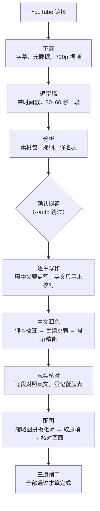

# 设计说明

这份文档解释这套工作流为什么要这样设计。只是想用的话，读 [README](../README.md) 就够了。

## 要解决的问题

把英文访谈整理成中文，难的不是翻译，而是三件事同时做对：

- **不漏**：两三个小时的对话，最容易被悄悄略过的，恰恰是最尖锐、最有争议的那几段；
- **不歪**：数字、限定词、谁说的哪句话，一个都不能走样，编辑也不能借编者注替读者下判断；
- **好读**：读起来要像中文作者写的，没有"进行了讨论""这就是为什么"这类翻译腔，也没有满篇的破折号。

## 完整流程



每一步的产物都存在磁盘上，中断后可以从缺失的那一步接着跑。

## 几个设计取舍

### 忠实和好读，分开做

一边对着英文、一边用中文写，句子就会贴着英文的结构走，这是翻译腔的主要来源。所以写作、润色、核对拆成三步，每一步看的材料不同：

| 步骤 | 看什么 | 只管什么 |
|---|---|---|
| 写作 | 中文要点，英文只用来查数字、人名 | 把意思写全 |
| 润色 | 只看中文 | 读起来顺不顺 |
| 核对 | 中文对照英文 | 有没有漏、有没有走样 |

### 能数的，交给脚本

"不要翻译腔""不要遗漏"写在提示词里，模型未必照做，写长了还会忘。凡是能计数的规则，都写成了脚本：

- `lint_zh.py` 查禁用词、评判性措辞、翻译腔句式、破折号密度、长句、长引语、英文残留、口头禅、编造的神态动作（"笑着说""停顿了一下"）、正文里谈字幕和整理过程的句子，以及小标题是否只有话题没有结论；
- `coverage.py` 要求逐字稿的每一段都登记为"写入""合并"或"排除"，排除必须写明原因，而且不能以"太尖锐""有争议"为由。它还会算出每章"每分钟访谈写成多少字"，不到中位数一半的章节会被标为偏薄，这正是遗漏最常藏身的地方。

### 换一双没看过原文的眼睛

脚本查不出"读着像翻译"。所以每章交给一个只拿到中文正文的审读者，它看不到英文，也看不到润色记录，只负责挑出最拗口、最看不懂的几段。`blind_read.ps1` 会为每一章单独起一个 `codex exec` 进程，上下文完全隔离。换一个模型再读一遍，挑出的问题往往和第一轮不重合。

挑出的问题会逐条判断，不是照单全收。比如受访者自己用的比喻，审读者觉得"用力过猛"，也会保留原话，只改措辞。

### 规则是从返工里长出来的

[历史错误清单](../skills/interview-video/references/历史错误清单.md)整理了此前 13 篇长文里被指出、导致返工的问题，例如：遇到立场鲜明的受访者，最尖锐的段落被整段跳过；编者注紧跟在受访者观点后面，暗中反驳；编辑自己写的开头把年份写错；配图的图注写着"颁勋章"，画面上却没有在颁奖。每一条都对应到流程里的一道检查，流程每次开工前也会先读这份清单。

## 三道闸门

成稿前必须全部通过：

| 闸门 | 检查 | 不通过的例子 |
|---|---|---|
| 中文检查 `lint_zh.py --full` | ERROR 为 0；破折号每千字不超过 4 个；开头和结尾有原始链接；文末有复核说明 | 正文出现"逻辑关联不紧密"这类评判；正文写了"这段在字幕中不完整" |
| 覆盖检查 `coverage.py --article` | 逐字稿每一段都有登记；排除要有理由；章节标题对得上 | 有两段没登记；连续排除超过 3 分钟 |
| 配图核对 | 每张图都打开原图核对过，插图位置找得到 | 截图漂到了片尾的订阅卡 |

WARN 级别的提示不阻止通过，但要逐条处理：改掉，或者写明为什么保留。

## 省额度的做法

- 下载、整理字幕、截图、画质判断、插图、格式检查都由脚本完成，不消耗模型；
- 逐字稿只在分析时通读一遍，之后各步按时间范围只读对应片段；
- 章节正文写在文件里，负责调度的对话不把全文读进上下文；
- 根据检查脚本给出的行号定点修改，不重写整章；
- 精修只针对盲读挑出的段落和开头、结尾；
- 看图先粗后细：先看全片每 30 秒一格的缩略图拼板，再在候选位置附近细看，最后只打开选中的原图。

## 脚本单独使用

```powershell
# 下载并生成逐字稿
powershell -ExecutionPolicy Bypass -File tools\fetch.ps1 -Url "<链接>" -Slug "Guest_Show_123"

# 中文质量检查（成稿加 --full）
python -P tools\lint_zh.py 文章.md --full --json lint.json

# 逐字稿覆盖检查
python -P tools\coverage.py 素材\<slug>\transcript.md 素材\<slug>\覆盖表.csv --article 文章.md

# 缩略图拼板、取原帧、插图
python -P tools\frames.py sheet  素材\<slug>\video.mp4 素材\<slug>\sheets --end 02:30:00 --step 30
python -P tools\frames.py grab   素材\<slug>\video.mp4 素材\<slug>\配图计划.json <slug>_访谈长文_assets
python -P tools\frames.py insert <slug>_访谈长文.md 素材\<slug>\配图计划.json

# 盲读挑刺（每章一个独立的 codex exec 进程）
powershell -ExecutionPolicy Bypass -File tools\blind_read.ps1 -Dir 素材\<slug>
```
